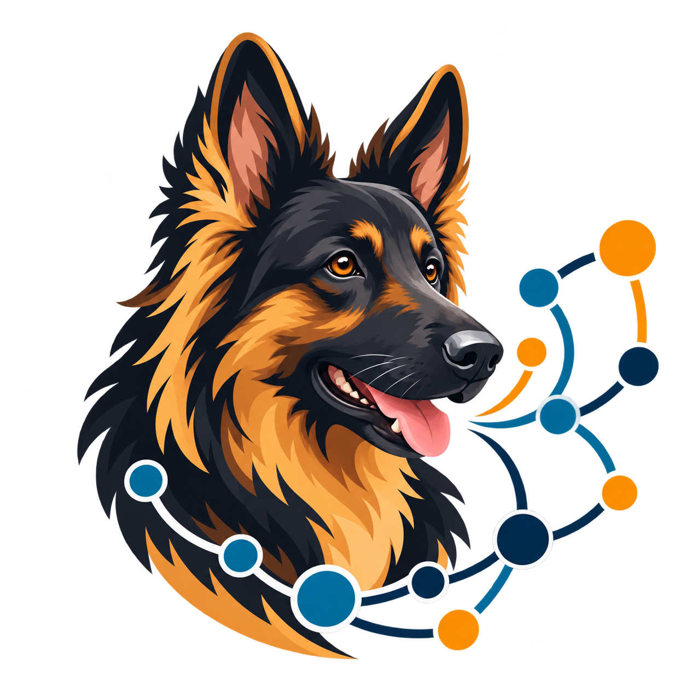
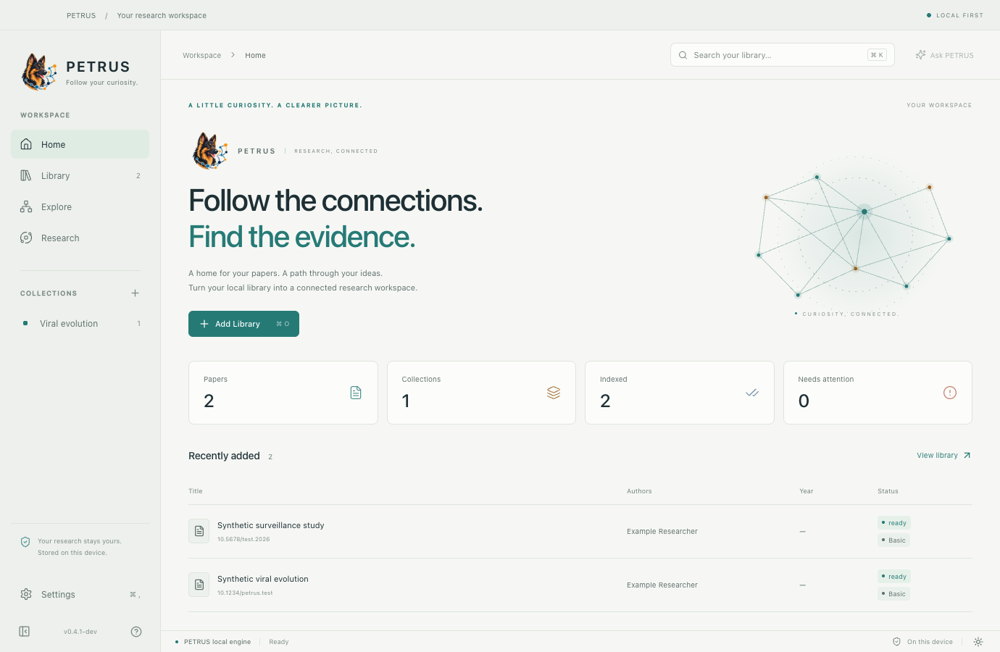
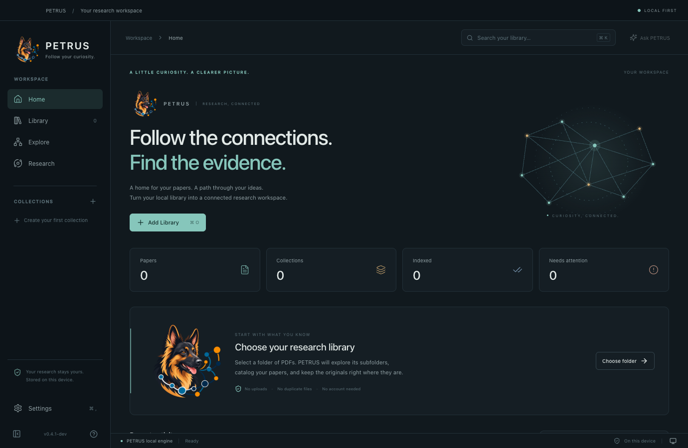
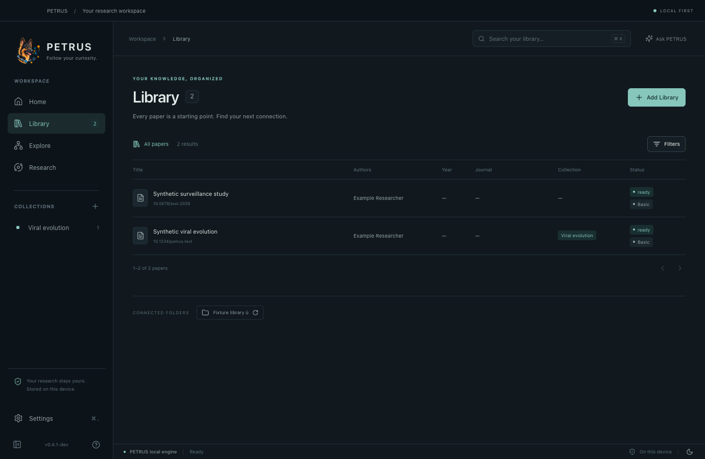
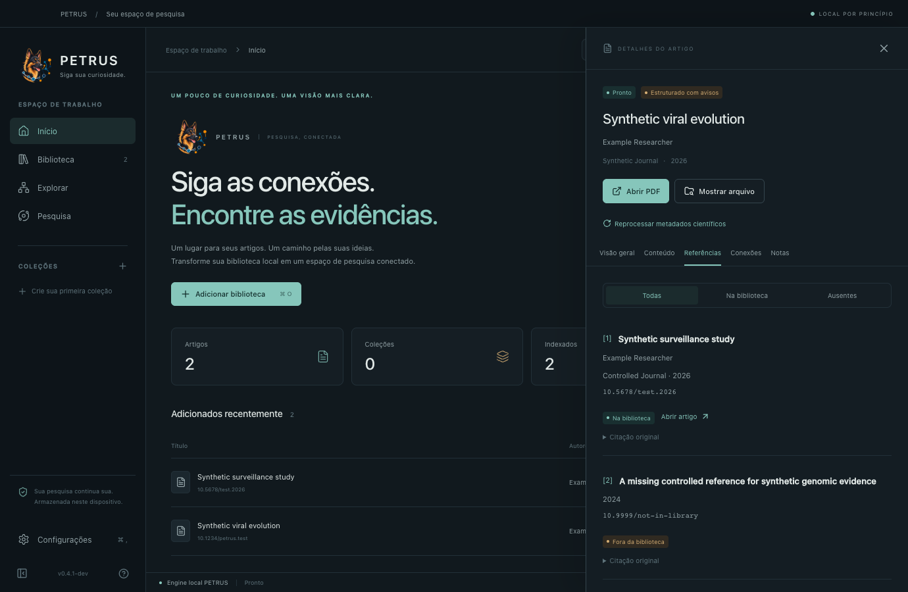
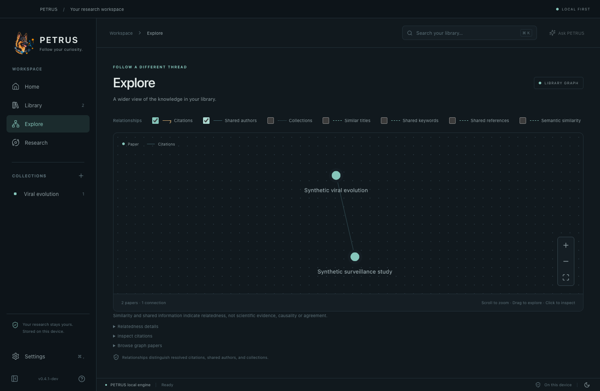
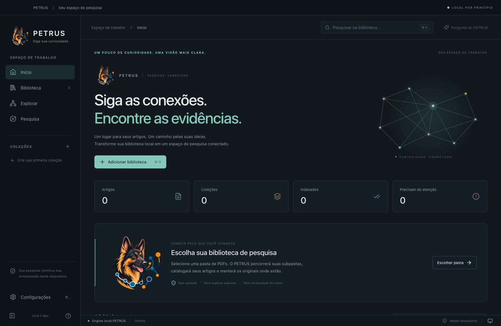
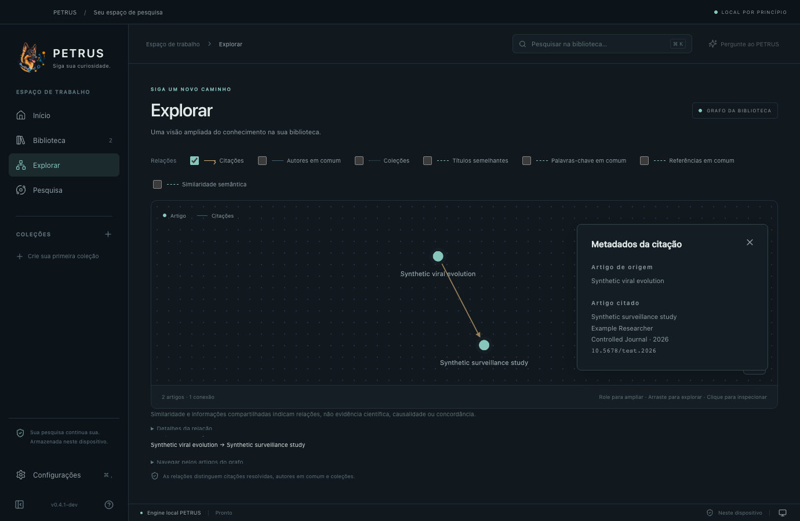

<p align="center">
  
</p>

<h1 align="center">PETRUS</h1>
<p align="center"><strong>Publication Evidence Tracking, Retrieval, Understanding &amp; Synthesis</strong><br>
<em>Follow the connections. Find the evidence.</em></p>

<p align="center">
  
  
  
  
  
  
  
</p>

<p align="center"><a href="#english">English</a> · <a href="#português-brasil">Português (Brasil)</a></p>



<p align="center"><em>Local research workspace · Espaço local de pesquisa</em><br>
Screenshots use synthetic test documents. · As capturas usam documentos sintéticos de teste.<br>
<a href="#usage">Usage</a> · <a href="#como-usar">Como usar</a></p>

## English

PETRUS is a local desktop research workspace that connects a PDF library to searchable text, paper relationships, saved evidence, a research trail and human-authored scientific claims. Optional local AI helps retrieve and explore sources; the researcher remains responsible for interpretation and conclusions.

**Created and developed by Alex Ranieri Jerônimo Lima. Current source version: 0.4.1-dev. Active development; not a stable public release.**

### Download the macOS app

**[Download PETRUS 0.4.1-dev — Apple Silicon (.dmg, about 34 MiB)](https://github.com/alex-ranieri/PETRUS/releases/download/v0.4.1-dev/PETRUS-0.4.1-dev-macos-arm64.dmg)**

Requires **macOS 14 or newer on an M1 or later Mac**. Open the DMG, drag PETRUS to Applications, then eject the image and launch the app. The Python engine/runtime is included; local AI and GROBID remain optional separate installations.

This is an **experimental prerelease with an ad hoc signature, without Apple notarization**. Read the [bilingual release and installation notes](https://github.com/alex-ranieri/PETRUS/releases/tag/v0.4.1-dev), including first-launch instructions, checksums, validation scope and backup guidance. Intel Mac, Windows and Linux installers are not included.

### Origin and philosophy

The earliest documented development milestone is **15 October 2026**, recorded in the [initial validation report](docs/validation.md). This is the documented starting point, not a verified date of the first idea or first line of code: this source directory had no Git history when prepared for GitHub.

The design expresses a practical research philosophy: finding a paper is only the beginning. A useful research workspace should help a researcher follow connections, return to the source, preserve the passage used as evidence and document how an interpretation changes over time.

PETRUS therefore prioritizes local control, inspectable provenance and explicit human decisions. PDFs stay in their original locations. Retrieved text, generated answers, saved evidence and scientific claims have distinct roles. Saving evidence, including or excluding it, assigning a relationship to a claim and marking a claim as reviewed require explicit researcher actions. Similarity is a discovery signal; it does not establish agreement, causation or scientific support.

The project remains in development. “Synthesis” in the expanded name describes the broader research ambition; the current Findings workflow preserves **human-written claims**, without automatic claim generation or automated scientific judgment.

### What PETRUS offers

- **A local PDF library:** multiple folders, recursive scanning, SHA-256 deduplication, multiple locations per document, collections, notes and full-text search with SQLite FTS5.
- **Inspectable sources:** extracted pages, optional GROBID structure and references, with conservative page attribution and provenance warnings when mapping is incomplete.
- **Exploration through relationships:** citation, author and collection graphs, plus optional derived and semantic similarity links, labeled separately from citations.
- **Optional hybrid retrieval and Ask PETRUS:** lexical and local embedding retrieval, clickable source cards and strict answer-format/citation validation. A structurally valid citation is not proof that the cited passage supports the answer.
- **Evidence that survives source changes:** explicitly saved snapshots preserve excerpts and provenance when a paper is reprocessed or becomes unavailable.
- **A research trail:** recorded questions, accepted answers, saved evidence, note revisions and decision transitions; older untracked activity is not reconstructed.
- **Human-authored Findings:** claims linked manually to evidence as supports, contradicts or context, with revisions, archive/restore and researcher review status.
- **English and Brazilian Portuguese:** translated interface, persistent language preference, light/dark/system themes; scientific source text is preserved in its original language.

### Usage

After [starting the desktop application](#run-from-source), follow this workflow. The screenshots illustrate selected development screens; Ask, Research Trail and Findings are described in the final steps below.

#### 1. Connect a PDF folder

On first launch, select **Choose folder** and point PETRUS to a local folder of PDFs. It scans subfolders and indexes available documents while keeping the original files in place. Use **Add Library** to connect additional folders.



#### 2. Search and organize your library

Open **Library**, search the indexed collection and use filters to narrow the results. Select a paper to inspect its details, open the original PDF, write a note or organize it in a collection. Missing metadata stays unknown rather than being filled with invented values.



#### 3. Inspect references and return to the source

For structured references, [enable the optional local GROBID service](docs/grobid.md) and explicitly reprocess a paper or library. In the paper panel, open **References** to inspect extracted entries and distinguish references resolved in the local library from those outside it. Use **Open paper** for a resolved entry or **Open PDF** to consult the original document. Check extraction warnings and page provenance before using a passage as evidence.



#### 4. Explore connections

Open **Explore** and choose the relationship types you want to see. Zoom, drag nodes and inspect links; keep citation links distinct from shared authors, collections and optional similarity relationships. A connection or similarity score does not establish scientific support.



#### 5. Ask the local library — optional

In **Settings → AI**, explicitly configure the local embedding and chat providers/models; build the embedding index if using semantic retrieval. Open **Ask PETRUS**, enter a question and inspect the returned Evidence Cards. Click a citation to locate its card, review the passage and open the source paper. A rejected answer is a generation failure, not a validated finding; check the original sources even when an answer is accepted.

#### 6. Preserve evidence and write your findings

Use **Save evidence** on a card to choose or create a Research Session. In **Research**, review saved snapshots, set **Included / Excluded / Uncertain**, write your own notes and inspect the **Research Trail**. In **Findings**, write a claim yourself and manually link saved evidence as **Supports / Contradicts / Context**. Marking a claim **Reviewed** records your review; it is not peer review or automated verification.

### Comparative advantages and tradeoffs

These are workflow differences and design advantages for particular needs, **not head-to-head benchmark results or claims of exclusive features**. Other tools may provide overlapping capabilities. Their official documentation is linked below; features can change.

| Compared with | Where PETRUS can help | Where the alternative is stronger or PETRUS is limited |
|---|---|---|
| Reference managers such as [Zotero](https://www.zotero.org/support/quick_start_guide) | Combines source passages, preserved evidence, a research trail and explicit claim–evidence relationships in one local workflow. | Zotero documents bibliography creation, word-processor integration and library syncing. PETRUS does not provide those workflows and should complement an established reference manager. Zotero also supports local use; local storage is not unique to PETRUS. |
| Citation discovery tools such as [ResearchRabbit](https://learn.researchrabbit.ai/en/articles/17309356-how-to-read-the-citation-map-in-researchrabbit) | Connects exploration directly to the PDFs already held locally, then to saved passages and researcher claims. | PETRUS has no external literature discovery service; its graph reflects the local indexed corpus and configured limits. It cannot establish comprehensive coverage of a field. |
| AI review workflows such as [Elicit](https://support.elicit.com/en/articles/14759154-systematic-reviews-in-elicit) | Keeps optional model inference local and makes evidence selection, claim wording and support/contradiction classification explicit human actions. | Elicit documents guided search, screening, extraction and reporting. PETRUS does not implement a complete systematic-review protocol, automated extraction tables or PRISMA reporting. |
| A standalone PDF chatbot or a folder of notes | Joins retrieval to persistent source snapshots, decision history and claim links rather than leaving the research record in a transient answer. | No representative comparison with PDF chatbots has been run. PETRUS has no continuous chat, guaranteed answer correctness or established productivity advantage. |

The main advantage is the **combination** of local operation, source preservation, evidence provenance and a researcher-controlled reasoning record. It is most useful when those properties matter more than cloud collaboration, broad literature discovery or automated review production. No comparative accuracy, speed, cost or user-study advantage has been established.

### Limitations and validation status

- **Platform and distribution:** development and packaging have focused on macOS Apple Silicon. Windows and Linux builds are untested. The downloadable macOS prerelease has an ad hoc signature and is not notarized by Apple. Generated mobile icons do not indicate mobile support.
- **PDF extraction:** no OCR. Scanned, encrypted, malformed or complex PDFs can fail or produce incomplete text. The basic parser caps processing at 300 pages and 100,000 characters per page. Metadata, DOI candidates and GROBID output require checking; missing page provenance stays unknown.
- **Coverage and scale:** no Crossref/OpenAlex discovery or external DOI verification. The graph is capped at 300 recent papers, 2,000 author/collection links per type and 4,000 citations; derived edges have additional limits. The embedding index uses SQLite and NumPy, not a benchmarked large-scale vector service.
- **AI reliability:** local models can hallucinate, omit evidence or fail the response contract. Validation checks structure and citation identifiers, not scientific entailment. Model and hardware choices affect quality, latency and memory use. Claims and evidence relationships are not judged by AI.
- **Audit boundaries:** snapshots do not reconstruct text that was never preserved. The trail is an application history, not a tamper-proof forensic ledger, complete event-sourced reconstruction or regulatory compliance certification. “Reviewed” means reviewed by the researcher, not peer review or verified truth.
- **Privacy boundaries:** no application account or telemetry; configured parsing and AI services are restricted to loopback. Initial installation/model downloads require connectivity. Folder sync software and separately installed model/parser services have their own behavior. Extracted text, paths and potentially sensitive notes remain in the local database/logs; removing a library is not secure erasure. Database encryption is not provided by the application.
- **Validation:** the [0.4c report](docs/validation-0.4c-findings-claims.md) records 309 Python and 25 Playwright tests passing at that checkpoint. Those are historical results, not a fresh test run or a quality comparison with competing tools. Real-corpus claim validation remains pending the researcher's initial hypothesis, revision and research note. Automated tests do not replace native interaction or scientific validation.

### Technical specifications and development disclosure

| Layer | Technologies and role |
|---|---|
| Desktop shell | Tauri 2, Rust 2021 edition, native dialogs and IPC |
| Interface | React 19, TypeScript, Vite 6, CSS, Cytoscape.js, i18next |
| Research engine | Python 3.11+, pypdf, NumPy; packaged with PyInstaller |
| Persistence | SQLite, SQL migrations, WAL, foreign keys and FTS5; local embedding storage |
| Optional structured parsing | GROBID running as a separate local service |
| Optional AI runtime | LM Studio native API or a separately selected OpenAI-compatible **local** endpoint; embedding and chat models selected explicitly |
| Development and checks | Node.js 22+, npm lockfile, stable Rust, Python dependency locks, pytest, Playwright, Ruff, ESLint and TypeScript checks |
| Development platform | macOS / Apple Silicon (arm64). Exact original chip model, RAM and minimum AI hardware requirements have not been documented; no hardware benchmark is claimed. |
| AI-assisted development | **OpenAI Codex was used to assist development, implementation, debugging and documentation.** This is a development-tool disclosure, not an application runtime dependency. No exact Codex model/version or contribution percentage is asserted. Scientific interpretation and validation remain the researcher's responsibility. |

The repository's manifests and lockfiles specify dependencies. Models, GROBID/JVM and development tools are not all bundled together. A packaged desktop build includes the Python engine/runtime; optional parsing and model services must be configured separately. Codex is not required to run PETRUS.

### Run from source

On macOS 14 or newer, install Xcode Command Line Tools, Node.js 22+, Python 3.11+ and stable Rust. From the repository root:

```bash
npm ci
python3 -m venv .venv
.venv/bin/python -m pip install -r engine/requirements-dev.lock
.venv/bin/python -m pip install -e engine --no-deps
.venv/bin/python scripts/package_engine.py
npm run desktop
```

For an isolated development database, replace the last command with:

```bash
PETRUS_DATA_DIR="$PWD/.local-data/development" npm run desktop
```

`npm run dev` starts only the frontend; use `npm run desktop` for the functional application. Dependencies and generated artifacts must be recreated after cleanup.

```bash
# Repackage after Python or migration changes, then build a development app
.venv/bin/python scripts/package_engine.py
npm run desktop:build

# Checks (Playwright also requires the frontend running via npm run dev)
.venv/bin/python -m pytest engine/tests -q
.venv/bin/ruff check --config ruff.toml engine scripts
npm run lint
npm run build
npm exec playwright -- test
```

GROBID setup: [local parsing guide](docs/grobid.md). Model downloads and local server setup are separate, explicit steps; PETRUS does not select or download models automatically.

### Planned implementations

These are planned directions, not available features or dated delivery promises. See the [detailed roadmap](docs/roadmap.md) for dependencies and acceptance criteria.

- **PDF discovery and acquisition agent:** search by question, topic or DOI; expand references; propose candidate papers and retrieve legally accessible PDFs into a user-selected folder. Keep URLs, identifiers, retrieval dates, access/license information when available and hashes; deduplicate and queue indexing. Show search/acquisition activity and require explicit approval for downloads, with an optional bounded batch policy. No paywall bypass or claim that discovery is exhaustive. External search is an opt-in online capability; local reading remains separate.
- **Local AI without requiring LM Studio:** evaluate an Ollama provider with explicit chat/embedding selection and a model-download manager. Offer size/license/hardware information, progress, cancellation, storage controls and offline inference after download. Only downloaded local models would be eligible; a localhost endpoint alone does not rule out cloud-backed models.
- **A more self-contained AI experience:** evaluate a managed local inference runtime and optional downloadable model packs. Ollama integration is an initial route, not equivalent to embedding its runtime inside PETRUS. Bundling a runtime or model requires separate packaging, license review and platform testing. No default model or hardware requirement has been selected.
- **Cross-platform releases:** validate macOS Apple Silicon first, then Windows x64 and Linux x64, with per-platform engine builds, installers, native smoke tests and versioned release assets. Additional architectures require separate validation.
- **Research workflow improvements:** exports/report building, carefully scoped synthesis assistance, OCR, metadata correction, job cancellation and accessibility. Any future synthesis must remain clearly separated from human-authored claims and require researcher review.

### Documentation, roadmap and licensing

[Architecture](docs/architecture.md) · [Database](docs/database.md) · [Roadmap](docs/roadmap.md) · [Internationalization](docs/i18n.md) · [Findings validation](docs/validation-0.4c-findings-claims.md) · [Historical development notes](docs/development-history.md)

Current work focuses on consolidating the evidence workspace and validating real research workflows. Future scope is described in the roadmap and is not a delivery commitment. Collaboration/sync, broad discovery, OCR and cross-platform distribution should not be assumed available.

**License:** no project license has been selected in this source tree. Publishing source on GitHub does not by itself grant an open-source license. A license decision is pending; third-party components retain their own licenses. No institutional endorsement is implied.

## Português (Brasil)

PETRUS é um ambiente desktop local de pesquisa que conecta uma biblioteca de PDFs a busca textual, relações entre artigos, evidências salvas, trilha de pesquisa e afirmações científicas escritas pelo pesquisador. A IA local é opcional e auxilia a recuperação e a exploração das fontes; a interpretação e as conclusões continuam sob responsabilidade humana.

**Criação e desenvolvimento: Alex Ranieri Jerônimo Lima. Versão do código: 0.4.1-dev. Projeto em desenvolvimento, sem release pública estável.**

### Baixar o aplicativo macOS

**[Baixar PETRUS 0.4.1-dev — Apple Silicon (.dmg, cerca de 34 MiB)](https://github.com/alex-ranieri/PETRUS/releases/download/v0.4.1-dev/PETRUS-0.4.1-dev-macos-arm64.dmg)**

Requer **macOS 14 ou mais recente em Mac M1 ou posterior**. Abra o DMG, arraste PETRUS para Aplicativos, ejete a imagem e abra o app. O pacote inclui engine/runtime Python; IA local e GROBID continuam como instalações opcionais separadas.

Esta é uma **pré-release experimental com assinatura ad hoc, sem notarização Apple**. Leia as [notas bilíngues da release e instalação](https://github.com/alex-ranieri/PETRUS/releases/tag/v0.4.1-dev), incluindo primeira abertura, checksums, escopo da validação e backup. Não inclui instaladores para Mac Intel, Windows ou Linux.

### Origem e filosofia

O primeiro marco de desenvolvimento documentado é **15 de outubro de 2026**, conforme o [relatório inicial de validação](docs/pt-BR/validation.md). Essa é a data de início documentado; não confirma a data da primeira ideia ou linha de código, pois esta pasta ainda não tinha histórico Git ao ser preparada para publicação.

A filosofia do projeto parte de uma necessidade prática: encontrar um artigo é apenas o começo. O ambiente de pesquisa deve permitir seguir conexões, voltar à fonte, preservar o trecho utilizado como evidência e registrar como a interpretação evoluiu.

Por isso, o PETRUS prioriza controle local, proveniência inspecionável e decisões humanas explícitas. Os PDFs permanecem nas pastas originais. Texto recuperado, resposta gerada, evidência salva e afirmação científica têm papéis distintos. Salvar, incluir ou excluir evidências, classificar sua relação com uma afirmação e marcar a revisão são ações do pesquisador. Similaridade ajuda a descobrir relações; não demonstra concordância, causalidade ou sustentação científica.

O projeto continua em andamento. “Synthesis”, no nome expandido, expressa a ambição mais ampla; o fluxo atual de Achados preserva **afirmações humanas**, sem geração automática de claims nem julgamento científico automatizado.

### Recursos implementados

- **Biblioteca local:** múltiplas pastas, varredura recursiva, deduplicação SHA-256, múltiplas localizações, coleções, notas e busca FTS5.
- **Fontes inspecionáveis:** texto por página e estrutura/referências opcionais via GROBID, com avisos quando o mapeamento de páginas não é confiável.
- **Exploração de relações:** grafo de citações, autores e coleções, com relações derivadas e semânticas opcionais identificadas separadamente.
- **Recuperação híbrida e Ask PETRUS opcionais:** busca lexical e embeddings locais, cartões de fontes e validação de formato/citações. Citação estruturalmente válida não comprova sustentação científica.
- **Evidências preservadas:** snapshots explícitos mantêm trechos e proveniência quando a fonte é reprocessada ou fica indisponível.
- **Trilha de pesquisa:** perguntas registradas, respostas aceitas, evidências, versões de notas e mudanças de decisão. Atividade antiga não registrada não é reconstruída.
- **Achados humanos:** afirmações vinculadas manualmente como sustenta, contradiz ou contextualiza, com versões, arquivamento/restauração e status de revisão pelo pesquisador.
- **Interface bilíngue:** inglês e português brasileiro, preferência persistente e temas claro/escuro/sistema. O conteúdo científico mantém o idioma original.

### Como usar

Após [iniciar o aplicativo desktop](#run-from-source), siga este fluxo. As capturas ilustram telas selecionadas de desenvolvimento; Ask, Trilha de pesquisa e Achados são descritos nas etapas finais abaixo.

#### 1. Conectar uma pasta de PDFs

Na primeira execução, clique em **Escolher pasta** e selecione uma pasta local de PDFs. O PETRUS percorre as subpastas e indexa os documentos disponíveis, mantendo os arquivos originais onde estão. Use **Adicionar biblioteca** para conectar outras pastas.



#### 2. Pesquisar e organizar a biblioteca

Abra **Biblioteca**, pesquise o acervo indexado e use os filtros para restringir os resultados. Selecione um artigo para examinar os detalhes, abrir o PDF original, escrever uma nota ou organizá-lo em uma coleção. Metadados ausentes permanecem desconhecidos, sem preenchimento com valores inventados.


#### 3. Inspecionar referências e voltar à fonte

Para obter referências estruturadas, [ative o serviço local opcional GROBID](docs/pt-BR/grobid.md) e reprocesse explicitamente um artigo ou biblioteca. No painel do artigo, abra **Referências** para examinar as entradas extraídas e distinguir referências resolvidas na biblioteca local das que estão fora dela. Use **Abrir artigo** para uma entrada resolvida ou **Abrir PDF** para consultar o documento original. Confira os avisos de extração e a proveniência das páginas antes de usar um trecho como evidência.


#### 4. Explorar conexões

Abra **Explorar** e escolha os tipos de relação que deseja visualizar. Use zoom, arraste os nós e inspecione os vínculos; diferencie citações de autores em comum, coleções e relações opcionais de similaridade. Conexão ou pontuação de similaridade não demonstra sustentação científica.



#### 5. Perguntar à biblioteca local — opcional

Em **Configurações → IA**, configure explicitamente os providers e modelos locais de embeddings e chat; construa o índice de embeddings se utilizar recuperação semântica. Abra **Pergunte ao PETRUS**, envie uma pergunta e examine os cartões de evidência retornados. Clique em uma citação para localizar seu cartão, conferir o trecho e abrir o artigo de origem. Resposta rejeitada é falha de geração, não achado validado; confira as fontes originais mesmo quando a resposta for aceita.

#### 6. Preservar evidências e escrever seus achados

Use **Salvar evidência** em um cartão para escolher ou criar uma Sessão de pesquisa. Em **Pesquisa**, revise os snapshots salvos, defina **Incluída / Excluída / Incerta**, escreva suas próprias notas e examine a **Trilha de pesquisa**. Em **Achados**, escreva uma afirmação e vincule manualmente evidências como **Sustenta / Contradiz / Contextualiza**. Marcar uma afirmação como **Revisada** registra sua revisão; não equivale a revisão por pares ou verificação automatizada.

### Vantagens comparativas e contrapartidas

A comparação descreve escolhas de fluxo, **sem benchmark direto, exclusividade ou superioridade geral**. As ferramentas podem ter recursos sobrepostos; suas documentações oficiais estão vinculadas na tabela em inglês.

| Comparação | Vantagem de uso do PETRUS | Contrapartida |
|---|---|---|
| Gerenciadores como Zotero | Reúne trechos, snapshots, trilha de decisões e vínculos entre afirmações e evidências num fluxo local. | Não oferece geração de bibliografias, integração com editores ou sincronização de bibliotecas. Complementa um gerenciador consolidado. Zotero também funciona localmente. |
| Descoberta por citações como ResearchRabbit | Conecta a exploração aos PDFs locais e depois às evidências e afirmações do pesquisador. | Não possui descoberta externa; o grafo depende do acervo indexado e dos limites de exibição. Não garante cobertura de uma área. |
| Revisões assistidas por IA como Elicit | Mantém inferência opcional local e decisões explícitas sobre seleção, redação e relações de evidência. | Não implementa protocolo completo de revisão sistemática, tabelas automáticas de extração ou relatório PRISMA. |
| Chat isolado com PDFs ou pastas de notas | Integra recuperação, snapshots, histórico e vínculos persistentes entre evidências e afirmações. | Sem comparação representativa com chatbots, chat contínuo, garantia de correção ou ganho de produtividade estabelecido. |

O diferencial central é a **combinação** de execução local, preservação das fontes, proveniência e registro das decisões sob controle do pesquisador. É uma escolha adequada quando essas propriedades têm prioridade sobre colaboração em nuvem, descoberta ampla ou produção automatizada de revisões. Não há superioridade demonstrada em precisão, velocidade, custo ou estudos com usuários.

### Limitações e validação

- **Plataforma:** desenvolvimento e empacotamento concentrados em macOS Apple Silicon. Windows/Linux não testados; assinatura ad hoc, sem notarização pública Apple. Ícones móveis não significam suporte móvel.
- **Extração:** sem OCR; PDFs digitalizados, protegidos ou complexos podem falhar. Parser básico limitado a 300 páginas e 100 mil caracteres por página. Metadados, candidatos a DOI e saída GROBID exigem conferência; páginas desconhecidas não são inventadas.
- **Cobertura e escala:** sem descoberta Crossref/OpenAlex ou validação externa de DOI. Grafo de até 300 artigos recentes, 2.000 vínculos de autor/coleção por tipo e 4.000 citações; relações derivadas têm limites adicionais. SQLite/NumPy não foram demonstrados como solução vetorial de grande escala.
- **IA:** modelos podem alucinar, omitir evidências ou falhar no contrato. Validação estrutural não verifica sustentação científica. Qualidade, latência e memória dependem do modelo e hardware. Claims e relações não são julgadas por IA.
- **Histórico:** snapshots não recuperam texto nunca preservado. A trilha não é registro forense inviolável, reconstrução completa por eventos ou certificação regulatória. “Revisada” significa revisão pelo pesquisador, sem equivalência a revisão por pares ou verdade verificada.
- **Privacidade:** sem conta ou telemetria; serviços configurados de parsing/IA restritos a loopback. Instalação e downloads iniciais precisam de rede. Sincronizadores de pastas e serviços externos ao app têm comportamento próprio. Banco/logs locais guardam texto, caminhos e notas; remover biblioteca não é apagamento seguro. O aplicativo não fornece criptografia do banco.
- **Validação:** o [relatório 0.4c](docs/pt-BR/validation-0.4c-findings-claims.md) registra 309 testes Python e 25 Playwright aprovados naquele marco, sem reexecução nesta preparação ou comparação com concorrentes. A validação das claims com corpus real ainda depende da hipótese inicial, revisão e nota do pesquisador. Testes automatizados não substituem validação científica e interação nativa.

### Especificações e participação do Codex

| Camada | Especificação |
|---|---|
| Desktop | Tauri 2, Rust edição 2021, diálogos nativos e IPC |
| Interface | React 19, TypeScript, Vite 6, CSS, Cytoscape.js e i18next |
| Engine | Python 3.11+, pypdf e NumPy; empacotamento PyInstaller |
| Persistência | SQLite, migrations SQL, WAL, chaves estrangeiras, FTS5 e embeddings locais |
| Parsing opcional | GROBID como serviço local separado |
| IA opcional | LM Studio nativo ou endpoint local OpenAI-compatible escolhido separadamente; modelos explícitos de chat e embeddings |
| Desenvolvimento | Node.js 22+, npm/locks, Rust estável, locks Python, pytest, Playwright, Ruff, ESLint e TypeScript |
| Plataforma utilizada | macOS / Apple Silicon (arm64). Modelo original do chip, RAM e requisitos mínimos de IA não documentados; sem benchmark de hardware. |
| Assistência na codificação | **OpenAI Codex participou como ferramenta de assistência ao desenvolvimento, implementação, depuração e documentação.** Não é dependência de execução do aplicativo. Não são atribuídos modelo/versão específicos ou percentual de contribuição. Interpretação científica e validação permanecem sob responsabilidade do pesquisador. |

As versões são especificadas nos manifests e locks. O pacote desktop inclui engine/runtime Python; GROBID/JVM e modelos opcionais exigem configuração separada. O Codex não é necessário para usar o PETRUS.

### Implementações planejadas

São direções futuras, sem disponibilidade atual ou prazo prometido. O [roadmap detalhado](docs/pt-BR/roadmap.md) registra dependências e critérios de aceitação.

- **Agente de busca e aquisição de PDFs:** buscar por pergunta, tema ou DOI, expandir referências, sugerir artigos e obter PDFs com acesso autorizado numa pasta escolhida. Registrar URLs, identificadores, datas, condições de acesso/licença quando disponíveis e hashes; deduplicar e encaminhar à indexação. Downloads exigirão confirmação explícita ou política de lote previamente autorizada e limitada. Sem contornar paywalls nem prometer busca exaustiva. A busca externa será online e opcional, separada da leitura local.
- **IA local sem exigir LM Studio:** avaliar integração Ollama com escolha explícita de chat/embeddings e gerenciador de downloads. Exibir tamanho, licença, requisitos, progresso, cancelamento e controle de armazenamento; após o download, inferência offline com modelos locais. Endpoint localhost, sozinho, não exclui modelos executados em nuvem.
- **Experiência de IA mais autossuficiente:** avaliar runtime gerenciado pelo PETRUS e pacotes opcionais de modelos baixáveis. Integrar Ollama não equivale a embarcá-lo no aplicativo; distribuir runtime/pesos exige análise de licença, empacotamento e testes por plataforma. Ainda não há modelo padrão ou requisito mínimo de hardware definido.
- **Releases multiplataforma:** validar primeiro macOS Apple Silicon, depois Windows x64 e Linux x64, com engine próprio de cada plataforma, instaladores e testes nativos. Outras arquiteturas exigirão validação específica.
- **Melhorias do trabalho científico:** exportação/relatórios, assistência à síntese com escopo próprio, OCR, correção de metadados, cancelamento de jobs e acessibilidade. Síntese futura deverá permanecer distinta das claims humanas e depender de revisão do pesquisador.

### Executar, acompanhar e contribuir

No macOS 14 ou mais recente, instale Command Line Tools, Node.js 22+, Python 3.11+ e Rust estável. Os comandos completos de instalação, execução, banco isolado, build e testes estão em **Run from source**, acima; são os mesmos para ambos os idiomas. `npm run desktop` abre o aplicativo funcional; `npm run dev` inicia somente a interface. Após limpeza, reinstale dependências e regenere artefatos.

Consulte [arquitetura](docs/pt-BR/architecture.md), [banco](docs/pt-BR/database.md), [roadmap](docs/pt-BR/roadmap.md), [GROBID](docs/pt-BR/grobid.md), [internacionalização](docs/pt-BR/i18n.md), [validação de Achados](docs/pt-BR/validation-0.4c-findings-claims.md), [notas históricas](docs/pt-BR/development-history.md).

A continuidade prioriza consolidar o workspace e validar fluxos reais. Itens futuros não são compromissos de entrega; colaboração/sync, descoberta ampla, OCR e distribuição multiplataforma não devem ser presumidos disponíveis.

**Licença:** ainda não foi escolhida uma licença do projeto. Publicar o código no GitHub não o torna automaticamente open source. Componentes de terceiros mantêm suas próprias licenças. Não se presume endosso institucional.
