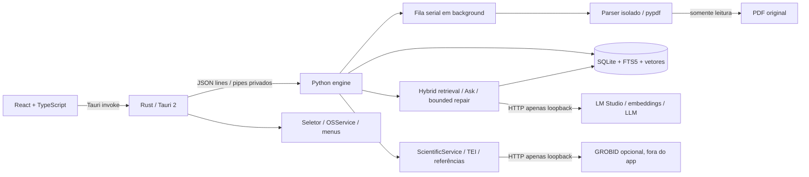

**English** · [Português (Brasil)](pt-BR/architecture.md)

# PETRUS Architecture

## CURRENT — 0.4.1-dev / Research Trail

This block describes the current code. The evolution sections below record the state of each step and their historical limits; old claims of "not implemented", "reserved", or "OpenAI-compatible only" do not apply to CURRENT.

- **Local operational retrieval:** EvidenceUnits with IDs/provenance/pages, subdivision without loss, embeddings in SQLite and hybrid search FTS5 + similarity by RRF. Settings, thresholds, selection and prompts were frozen for stabilization.
- **Operational Ask PETRUS:** question in EN/PT-BR, retrieved sources, clickable citations and Evidence Cards, navigation to library/PDF; strict validation of JSON/IDs/citations by paragraph. Structural acceptance does not prove scientific entailment.
- **Recommended Provider:** LMStudioNativeLLMProvider, loopback `POST /api/v1/chat`, baseline `qwen/qwen3.5-9b`, reasoning=off by capability. OpenAICompatibleLLMProvider uses `/v1/chat/completions` as a separate option; it is not automatic fallback.
- **Capability-aware reasoning:** capability with off sends off; present without off blocks; absent omits the field and accepts only final message. Separate reasoning is discarded as content and retained only as metrics/types, never as answer/repair/research event.
- **Bounded repair:** one original generation and at most one structural repair with the same context and without new retrieval. Invalid output is never presented/saved as answer. Technical failure is distinct from validated scientific abstention.
- **Graph:** CITES, SHARED_AUTHOR, SAME_COLLECTION, TITLE_SIMILARITY, SHARED_KEYWORDS, SHARED_REFERENCES and SEMANTIC_SIMILARITY are implemented. Derived filters are optional; similarity is not scientific evidence.
- **Native Settings:** temperature 0.1; context 8192; defaults `llm_max_output_tokens=1600` and `llm_timeout_seconds=90`. Explicit EN/PT-BR controls preserved, with backend validation. The 4B probe did not change the defaults nor the user's model choice.
- **Validated embedding baseline:** `text-embedding-nomic-embed-text-v1.5`, 768 dimensions, `/v1/embeddings`. There is no reindexing at this stage; Ask uses the query embedding from the existing provider.
- **Model discovery (0.3.1-dev):** Settings uses `LocalModelSelect` for chat/embedding from the LM Studio provider. The allowed Rust operation `llm_models` forwards to the engine `llm/catalog.py`, which performs only `GET /api/v1/models` in loopback HTTP, timeout 3 s, response limited to 1 MB, without proxy/redirect. Normalizes known fields and omits raw payload; missing ones stay null, unrecognized type becomes unknown. The helper `reasoning_capability` is shared with the native provider; the inference policy remains the same. Refresh rereads the runtime without mutating SQLite/settings, selection or models. State is only in component memory, without persistent cache; old responses are discarded when changing endpoint/unmounting. Choosing an ID changes only the draft; Save and Save and check maintain existing semantics. Missing IDs/offline and custom input are preserved. OpenAI-compatible does not use discovery. Validation in [validation-0.3.1-model-discovery.md](validation-0.3.1-model-discovery.md).
- **0.3.0-dev checkpoint distribution:** macOS Apple Silicon, development checkpoint with bundled sidecar Python and ad hoc signature; no publication/notarization. Native manual check and the package visual smoke test were confirmed by the user; the CLOSE_0_3 recommendation is documented in [validation-0.3-final.md](validation-0.3-final.md).

Validation history: [9B bounded repair](validation-0.3b1c-ask-robustness.md), [4B comparison](validation-0.3b1d2-nonconfigurable-reasoning.md). 4B remains supported; it is not the recommended baseline under the validated budget.

## Scientific workspace 0.4a (base preserved; implementation history)

The UI adds `SaveEvidenceDialog` to Ask and `ResearchEvidenceWorkspace` to a session detail. The target session of Ask is an explicit in-memory choice by the UI; no global setting was created. The existing list of sessions and their registration are reused. New operations `research_evidence_save/list/get/update/remove` are in the Rust allowlist and are served by `ResearchEvidenceService`.

The `ask` handler of the service continues to call the same `AskPetrusService`, with the same retrieval/LLM/validator/repair. After obtaining the response, it adds an opaque `response_id`. A volatile record, limited to the last 16 responses of the process, keeps only the question, Evidence Cards, and final status, without a generated response or reasoning. This receipt allows verifying which unit and local E# label belong to the question, even when generation fails. After expiring/restarting the engine, an unsaved card requires a new question; already saved evidence persists normally. An already persisted Ask event can also substantiate the origin, with membership verification. There is no automatic saving of response, Ask event, or evidence.

Saving reserves the SQLite transaction (`BEGIN IMMEDIATE`), checks session, current unit, paper, text, provenance, pages, and evidence role; it reconstructs the snapshots in the engine. When there is a receipt/event, it also checks membership to the response. Arbitrary frontend fields cannot become part of the source. The origin is derived from the verified status: `ask_answer` for accepted response; `retrieved_source` in other cases with recovered source. The E# label is never a global key.

The `005_research_evidence.sql` migration creates the snapshot, optional FKs with SET NULL for sources and uniqueness by session/fingerprint. The canonical hash uses SHA of the paper and text, pages, provenance, and semantic identity of section/source (heading, type, origin, and subdivision offsets), without depending on the numeric IDs replaced by parsing.

Decision starts uncertain; only human update changes included/excluded/uncertain and user_note. The note is preserved exactly as received, without trim/translation/rewriting. The UI saves the note via button, not per keystroke. Updates without change do not generate an event. Snapshots are not editable by the update operation. Basic events store IDs, fingerprint, timestamp and decision transitions; they do not replicate excerpts/notes or reasoning. Removal performs event and hard delete in the same transaction. Session deletion, if performed, follows the existing CASCADE and removes items/events; there is still no session deletion operation in the UI.

Source availability is designed from paper_id and paper_files.available, according to the local catalog/last scan; it does not perform a new scan nor reprocessing. Source reprocessing/deletion does not rewrite snapshots. A source change detector nor automatic ID remapping has not been implemented. Source actions use the current paper when available; otherwise the snapshot remains visible. There is no synthesis, findings/claims or complete Research Trail at this stage.

## Research Trail 0.4b

`research_evidence` continues current state authority. The history uses the same table `research_events`, evolved by migration 006. `trail.py` centralizes canonical writing, compact paginated projection and on-demand details. The UI `ResearchSessionWorkspace` keeps the 0.4a workspace in the Evidence tab and adds `ResearchTrail`, with actor filters and links. `research_trail_list/get` are in the Rust allowlist. There is no second log, replay, global event sourcing or AI-suggested mutation.

The target-session selector appears before the question and is an explicit UI choice, without a global setting. `ask` without a session preserves the exploratory behavior. With a valid session, it records `question_asked`, executes the same Ask, and records recovery plus result in a subsequent short transaction. It does not keep SQLite open during generation. A subsequent failure returns `trail.state=failed` with a localized warning; the Ask answer remains available, without a new generation to attempt registering the trail. If an exception prevents completing the Ask, a safe technical event represents the failure; an abrupt interruption may leave only the question, without a fabricated result.

The observation involves the existing retriever instance: it intercepts its returns and does not perform extra retrieval, embedding, or generation. It records QueryPlan, current settings, identities/hashes of selected units, observed ranks and scores, and counts returned per source. `returned_candidate_count` is the quantity returned, limited to 30, not the unrestricted size of the candidate universe. `max_hits_per_paper=2` describes the existing diversity preference, which can fill vacancies with surpluses; it does not promise an absolute ceiling. If the core uses its internal lexical fallback, the ranks of that other retriever are not observed: the trail reports `ranking_observed=false`, lexical_fallback strategy, and unknown fields, without repeating the search to invent numbers. Observation failure should also not turn a successful retrieval into a fallback. There are no complete retrieval segments in the event; the context hash is calculated over identities/QueryPlan/configuration, not over the hidden prompt.

The actor policy is: explicit session creation, question, manual answer save, and evidence actions are `user`; final accepted answer and validated LLM abstention are `ai`; retrieval, rejection, technical failure, and boundary are `system`. Absence of source (`no_evidence`) generates system abstention, without attributing a non-existent generation to the AI. The old type `ask` continues to represent the manual save, designed as `ask_saved_to_session`, without a parallel equivalent event.

The accepted answer contains the final snapshot and revalidated citations. Rejection/failure retains only permitted technical codes and execution summary. There is no reasoning, prompts, invalid candidates, or raw error messages in the events. The volatile receipt remains limited to 16 questions/selections/status and adds only the ID of the persisted result. An explicit save may reference this result; after losing the receipt, a persisted source is verified by identity, SHA text, and, when known, paper SHA/fingerprint. This does not automatically remap reprocessed units.

Notes deliberately retain each exact new version after Save note and real change, with previous/new hash; they do not capture typing. Save/update/remove and their events share a transaction. A new save preserves a durable historical copy of the source; remove references that event and preserves identity, title, section, pages, and decision. On removal of a legacy item whose old save had no excerpt, it captures the existing snapshot at that moment in a new event. It never rewrites the past. Old events do not allow recovering note versions that were not saved.

Events are immutable via API and trigger SQLite; corrections become new events. The FK CASCADE deletion policy for sessions is preserved, although there is no session deletion action in this UI. UTC is persisted and displayed in local timezone; `(created_at ASC, id ASC)` defines the deterministic order. Open/reopen is read-only of history; the migration inserts the boundary once for preexisting sessions.

## Findings / ResearchClaim 0.4c

`claims.py` adds a human domain alongside workspace/trail: `research_claims` is the current state of the claim and `research_claim_evidence` is the current state of the links. Findings is the name of the area, not a third entity. The engine is the validation authority; the nine operations `research_claim_*` are in the Rust allowlist. No Ask/retrieval/embeddings/LLM/graph code is altered or called by the domain.

Statement and researcher_note are exact human strings, with limits of 10,000/100,000 characters; no trimming of the valid value. Claim initiates draft. reviewed requires at least one persistent link, including a historical link whose source was subsequently removed: it is a minimum rule of organization, not semantic support verification. Actions on source, relation, or text do not automatically promote/demote status. Reviewed without links or with some source removed/unavailable shows a warning. Archive/restore preserves text/status/links; archived items are read-only and can be accessed via Trail or Archived filter.

Links are only accepted for SavedEvidence from the proprietary session of the claim, derived in the engine, reinforced by triggers. `UNIQUE(claim_id,evidence_fingerprint)` prevents duplication even after ID replacement. Repeating the link returns the existing link without changing its relation; changing it requires evidence_update. If a removed source is saved again with the same fingerprint, it is not silently remapped: the researcher can unlink and relink explicitly. Unlink removes the current link, preserving its historical event; removing SavedEvidence uses SET NULL and keeps the current link with stable metadata.

The link preserves identity and metadata, does not necessarily duplicate text. First, it searches for a compatible durable snapshot by fingerprint, SHA/text/paper in existing events of the session. Sources 0.4b normally reuse evidence_saved. A legacy item without historical text gets a snapshot on the first explicit claim_evidence_linked, without fabricating retroactive evidence_saved. Subsequent links reuse this reference. The snapshot is queried under explicit expansion via research_trail_get; there is no reprocessing or reconstruction. Link metadata/SHA/pages fields are not rewritten when the source changes.

Each mutation reserves BEGIN IMMEDIATE and emits canonical user/v1 events within the same transaction: claim_created, claim_statement_updated, claim_note_updated, claim_review_status_changed, claim_evidence_linked, claim_evidence_relation_changed, claim_evidence_unlinked, claim_archived, and claim_restored. Initial and new versions of statement/note, hashes, and transitions allow history reconstruction without editing old events. No reasoning integrates payloads. Reads do not create events; no-ops do not alter timestamps/history. Event failure reverts the entire mutation.

A UI `Findings` is the third tab of `ResearchSessionWorkspace`, preserving Evidence/Research Trail. It uses explicit forms, session source selector, active filters/counts, and bidirectional navigation. `ResearchEvidenceService.row` projects related claim IDs/status without modifying saved snapshots. The Trail adds version details and a link to the claim including archived ones. Statement/note and excerpts are rendered as escaped text, without automatic translation. There is no synthesis, export, claim graph, or automatic evaluation.

## Boundaries



There is no HTTP listener nor Python engine port. The scientific adapter makes outbound HTTP requests to GROBID on loopback when enabled; embedding/LLM providers also use exclusively loopback and explicit configuration. `engine_call` validates a list of operations in Rust; each JSON request has a sequence number and a response. The transport mutex maintains matching between requests and responses. The ingestion queue is a separate thread in Python, so status and search requests remain available during the scan. The frontend queries the state every 1.6 seconds.

The protocol is small and replaceable with another transport in the future. In the MVP, the engine has the database, migrations, extraction, and search; Rust has the OS integration and lifecycle. This prevents two layers from implementing the same schema and allows reusing the scientific core on Windows.

## Lifecycle

The shell starts a single Python process upon opening. In development, `scripts/desktop.mjs` defines `PETRUS_DEV_ENGINE=1` and the shell uses the `.venv`. In the package, it runs the PyInstaller sidecar alongside the main binary, including the Python runtime and migrations.

Upon closing, Rust closes the engine's stdin. Python cancels the active parser and signals the queue. Rust briefly waits for the close and applies forced termination as a fallback. A sudden interruption is recoverable by SQLite; on the next opening, in-progress jobs are marked as interrupted and can be rescanned. No exact byte/page resumption is promised.

Basic parsing uses subprocesses with a 60-second timeout, without network requests. Scientific parsing uses HTTP exclusively on loopback, with its own 60-second timeout. A parser failure does not crash the scanner. The queue is serial to limit CPU/memory usage on notebooks. There is no manual scan cancellation in this version.

## Ingestion and identity

`discover_pdfs` uses `os.walk`, preserves Unicode and spaces, does not follow internal symlinks, and ignores hidden and temporary directories. Traversal errors are logged. The scan has `discovered → hashing → metadata → text_extraction → indexed` stages, and each job stores total, completed, errors, and last file.

Each content has a unique SHA-256 in `papers`. The `paper_files` table registers one or more physical locations, with library, path, size, mtime in nanoseconds, availability, error, and scan token. Cloud-only files can be registered without `paper_id`, as there is no hash without reading. Their names and errors appear in the attention list.

Rescans reuse the location hash if size/mtime are unchanged; `verify_integrity` forces recalculation. Size/mtime also detect changes during reading. Canonical identity remains SHA-256. The file is verified before/after hashing and after parsing. Ready content is not extracted again. Modified content gets its own record; the location link passes to it. Old content remains retained in the database, without appearing in the library when no longer having a registered location.

After a complete traversal, unseen locations are marked as unavailable. If there is a traversal failure, this marking is omitted to avoid declaring a file removed in an inaccessible directory. An unavailable root folder produces a job with an error and preserves the catalog.

## Metadata parsing and quality

`PdfParser` defines `parse_metadata`, `extract_text`, `extract_pages`, and `extract_references`. `SimplePdfParser` implements pypdf. The basic implementation does not extract references; `GrobidPdfParser` provides the scientific result, with hierarchical sections and references, and reuses the pypdf pages layer.

DOI: search in metadata, first page, and the rest of the text; normalize prefixes/capitalization and terminal punctuation. The candidate is not confirmed externally. Title uses metadata or filename; authors come from the metadata field. Abstract uses a heuristic marked in the documentation. Year and journal remain unknown when the information is not reliable. Do not confuse `CreationDate` with publication.

There are limits of 300 pages, 100 thousand characters per page, and page content above 20 MB signaled as a warning. This content limit is applied after decompression; the separate process contains parser failures and memory excess, without promising a rigid process memory ceiling. OCR has not yet been implemented.

## Persistence and search

SQLite in WAL, `foreign_keys=ON`, lock timeout, and short connections per thread. Migrations are transactional and registered in `schema_migrations`. FTS5 indexes title, authors, DOI, abstract, and extracted text. Queries are parameterized; the search generates escaped Unicode terms with prefix matching and AND combination. It does not execute FTS syntax provided by the user.

## Graph and expansion

The graph combines resolved citations, collections, author names, deterministic relatedness, and optional semantic similarity via local embeddings. Each relationship has its own type, and only citations have direction. Name matching does not resolve person identity; two homonymous authors can create a link. No scientific evidence inference is derived from these links. The graph limits nodes/links to maintain responsive navigation.

References, sections, and source spans are derived from local TEI. `CITES` derives exclusively from locally confirmed resolution, without using fuzzy candidates as edges. Semantic retrieval, Ask, and SEMANTIC_SIMILARITY are operational via local opt-in. Evidence Cards preserve article, section, excerpt, provenance, and page when known; non-paginated units do not receive an invented page. Remote providers are not supported. The initial state without operational RAG is preserved in the incremental history below.

## System integration

`OSService` opens PDFs via the default app and reveals the file in Finder/Explorer; Linux opens the parent folder. It receives a paper ID and resolves paths registered in the engine. No shell interprets file names. `Path`/`PathBuf` compose paths. The selector uses the official Tauri dialog plugin, with capability restricted to the main window. The interface renders PDF text as escaped text.

System/Light/Dark are persisted in SQLite. The System theme follows the OS. Native menus preserve editing operations and search/folder/settings shortcuts. Assets and fonts are local. The only development server is Vite; it does not participate in the distributed package.

Technical references: [Tauri: managed state](https://v2.tauri.app/develop/state-management/), [Tauri: sidecars](https://v2.tauri.app/develop/sidecar/), [pypdf](https://pypdf.readthedocs.io/) and [SQLite FTS5](https://sqlite.org/fts5.html).

## Incremental history — 0.2 decisions

The dated sections below describe the code and validation **at that checkpoint**. Subsequent changes prevail; consult CURRENT for the current state.

`002_scientific_parsing.sql` extends the schema; migration 001 is preserved. `paper_basic_metadata` retains previous basic metadata and `parser_runs` stores attempts, TEI, and local warnings. `ScientificService.replace` replaces sections, references, and their spans in a single transaction, maintaining chunks/pages and notes. A subsequent failure preserves the last valid structure, signaled with a warning.

`GrobidService` controls unavailable/available/running/error states. It does not install nor start JVM automatically. The optional local service has its own configuration; details and limits in [grobid.md](grobid.md). `FileAvailabilityProvider` separates the macOS UF_DATALESS policy from the scanner, with a generic fallback for other platforms.

Sections preserve source headings and use deterministic canonical categories. Valid coordinates have preference; otherwise, only unique textual occurrences are aligned to pages. Spans may exist even when the full section interval is unknown. A section with unmapped parts maintains page_start/page_end NULL.

Local resolution prioritizes normalized and unique DOI, then exact normalized title with minimum length. Conflicting DOI, short title, or ambiguity prevent automatic resolution. Title similarity creates only a candidate. There is no definitive matching by author/year. The graph distinguishes CITES (directional), SHARED_AUTHOR, and SAME_COLLECTION. The graph's historical display fields are kept for compatibility; `type` contains the canonical code.

The UI uses i18next and the same catalogs are compiled in Rust for menus. Preferences `system/en/pt-BR` are independent of the theme. `PetrusLogo` centralizes variants and preserves the PNG and its ratio. The OSService contract receives the requested page and informs that the default application does not offer portable opening on page; there is no key automation or PDF editing.

See [i18n.md](i18n.md) for copy rules and scientific content.

## RAG foundation — internal step 0.2.1

> History 0.2.1: preparation of contracts before the 0.3 operational providers.

Prepared flow: **PDF → section → source span → EvidenceUnit → future embedding → future retrieval**. `rag/evidence.py` projects units directly from SQLite, without duplicating text or creating an index. Known spans are preferred; partially mapped sections also preserve their full text for discovery, without claiming pages. The basic layer is a fallback for articles without structure/spans.

| ProvenanceLevel | Origin | Future use policy |
|---|---|---|
| `coordinate` | `grobid_coordinates` | Can sustain paginated evidence, with source span and page |
| `exact_page_alignment` | `page_text_alignment` | Can sustain paginated evidence, with source span and page |
| `section_only` | Section without complete reliable span | Discovery/context; unit pages remain NULL |
| `basic_page_text` | Chunk from pypdf layer | Fallback/explore, without promotion to structured scientific evidence |

`supports_paginated_evidence` formalizes the policy. IDs `span:ID`, `section:ID` and `chunk:ID` identify records **from the current database**: reprocessing replaces rows, therefore a future index must invalidate/reconstruct their entries. They are not permanent global identifiers. `subdivide_span` is an identity boundary, without arbitrary cuts; future subdivisions must preserve paper, section, source span, pages and provenance.

`rag/contracts.py` defines only `EmbeddingProvider` (provider/model/dimension, documents and query), `RetrievalQuery` and `RetrievalHit` (EvidenceUnit + score). Existing `VectorIndex` and `LLMProvider` remain unchanged. There are no models, tokenizer, network calls, embeddings or operational retrieval.

Migration 003 adds JSON lists to `papers.scientific_warning_codes` and `parser_runs.warning_codes_json`; existing presentation messages/keys are preserved. Current codes: `page_mapping_partial`, `page_mapping_missing`, `grobid_invalid_response`, `grobid_timeout`, `grobid_unavailable`, `grobid_failed`, `pdf_size_limit`, `file_unavailable`, `rescan_required`, `file_changed`. There is no speculative metadata uncertainty code nor invented distinction for TEI size: adapter 0.2 groups this failure with invalid response. Backfill uses only known old keys and current structure; historical attempts without sufficient information remain with empty list. No human message is interpreted.

## Graph relatedness — internal step 0.2.2

> History 0.2.2: SEMANTIC_SIMILARITY was reserved; it was implemented in 0.3b.

`RelatednessService` calculates local relations on demand for articles visible in the graph, without migration or persistence of new edges. Unicode/casefold, punctuation, EN/PT stopwords and short/generic tokens are normalized deterministically.

- `TITLE_SIMILARITY`: Jaccard weighted by IDF **only of titles**; at least 3 shared terms and score ≥ 0,65.
- `SHARED_KEYWORDS`: terms derived from title + abstract, explicitly `derived_term`, because the current parser does not expose article keywords. Selects up to 12 terms per article by IDF; in a corpus of at least 5 articles, excludes terms present in more than 60%. Requires 3 shared and weighted Jaccard ≥ 0,20.
- `SHARED_REFERENCES`: bibliographic coupling by normalized DOI or, when absent, exact normalized title with at least 30 characters and 5 words. References do not need to be resolved locally. Deduplicates identities by article; requires 2 shared references and Jaccard ≥ 0,05. Does not use raw citation nor fuzzy matching; DOI and identity by title are not unified by inference.

Inverted indices generate unique pairs; postings above `max(40, 25% do corpus)` do not generate candidates. Scores are 0–1, with ratios in metadata: up to 10 terms or 5 reference examples. Maintains a maximum of 300 edges per type and degree 6 per article/type, prioritizing score and IDs for deterministic tie-breaking. These limits favor readability and may omit relationships; scores depend on the visible corpus, not a universal scientific measure.

The three filters start disabled; only citations start enabled. Derived relationships are non-directional, dashed, inspectable, and accompanied by a warning: similarity/shared information does not demonstrate scientific evidence, causality, or agreement. CITES persisted remains separate. The optional Related papers list in the detail is for later.

`SEMANTIC_SIMILARITY` is reserved only in the enum/type for **0.3**. No embedding, LLM, vector index, or RAG has been implemented. Verification 0.2.2: 8 new tests + 2 graph regressions passed (10 in 0.75 s), Ruff and TypeScript/ESLint of the modified files passed. No full build, visual test/Playwright, or real library processing occurred.

## 0.3a — Hybrid retrieval

> History 0.3a: Ask and semantic graph were implemented later, in 0.3b; the current package is treated in report 0.3c.

**EvidenceUnit → EmbeddingProvider → SQLiteVectorIndex → semantic retrieval**, alongside **FTS5 → RRF → hybrid retrieval**. Embeddings are derived/reconstructible, never a source of evidence: provenance and `supports_paginated_evidence` remain in EvidenceUnit. No LLM/chat generation.

Migration 004 creates `embedding_index`: float32 little-endian BLOB, dimension, hash, paper/unit/provider/model, timestamps and unit/provider/model uniqueness. NumPy calculates cosine in matrix, without external index or permanent cache in RAM. Cache uses text hash and identity/provenance/metadata; search ignores stale lines immediately and removes `remove_stale()`. Providers/models have independent indices; provider ID includes endpoint. If weights change under the same identifier, use `EmbeddingIndexService.clear()` and reindex explicitly.

`EmbeddingIndexService` offers `index_paper`, `index_all_available`, `remove_stale`, `status` and `clear`. Synchronous and explicit; considers only catalog-available papers, without opening PDFs. Units above `embedding_max_chars` (default 6,000) are skipped with `embedding_unit_too_large` returned by the operation, without truncation or extra history. Character limit must suit model context; tokenizer/subdivision deferred to 0.3b.

Actual provider uses HTTP `POST /v1/embeddings`, loopback only, without proxies/redirects/OpenAI SDK. `localhost` connects directly to 127.0.0.1. Timeout 30 s, maximum response 16 MB; validates model, order/count, dimensions and finite/nonzero vectors. No model downloads. Local-server authentication not added.

Existing FTS5 (`paper_search`) retains per-paper BM25; lexical overlap selects its EvidenceUnits, without a new passage FTS index. Hybrid fuses up to 30 candidates per source using RRF `1/(60+rank)`, without summing raw scores; ties use unit ID. Without provider/index, hybrid operates lexically; HTTP failure with an active index returns an explicit error.

**API configuration:** `embedding_provider="lmstudio"`, `embedding_endpoint="http://127.0.0.1:1234/v1"`, `embedding_model="IDENTIFICADOR_EXATO_DO_MODELO"`, `embedding_max_chars=6000`. Default provider `none`; default endpoint chosen only for LM Studio. Make an embedding model available in LM Studio, start Developer server and copy its exact identifier, retaining local access. These are user instructions: no real model/server was run in this validation. [Official local server](https://lmstudio.ai/docs/developer/core/server).

Engine JSON-lines operations (also in Rust allowlist):

```json
{"id":1,"method":"save_settings","params":{"embedding_provider":"lmstudio","embedding_endpoint":"http://127.0.0.1:1234/v1","embedding_model":"IDENTIFICADOR_EXATO_DO_MODELO","embedding_max_chars":6000}}
{"id":2,"method":"embedding_index","params":{"paper_id":1}}
{"id":3,"method":"embedding_status","params":{}}
{"id":4,"method":"semantic_search","params":{"query":"genomic surveillance","top_k":10}}
{"id":5,"method":"hybrid_search","params":{"query":"genomic surveillance","top_k":10}}
{"id":6,"method":"embedding_remove_stale","params":{}}
```

Search returns `hits` with full EvidenceUnit, paper/title, excerpt (600-character preview, without changing indexed text), score, lexical/semantic/hybrid ranks and evidence policy. No collection filter, new UI or embedding queue. `index_all_available` exists only as an explicit Python service operation; never triggered automatically.

Validation: **20 tests passed in 0.80 s** (14 new + 5 foundation + 1 migration); Ruff passed. FakeEmbeddingProvider and mocked HTTP transport enable offline tests. NumPy 2.5.4 is the only added runtime dependency and is locked. No real LM Studio/library, Playwright, TypeScript (UI unchanged), Tauri build or new full validation. The 0.2 `.app` remains unrecompiled. Semantic graph/paper representation, Ask PETRUS, LLM generation, evidence citations and reranking deferred to 0.3b.

## 0.3b — Evidence-aware retrieval and Ask PETRUS

> Initial 0.3b history: this chat transport precedes the 0.3b.1b native provider and 0.3b.1c bounded repair.

`EvidenceUnit.evidence_role` is a deterministic section/ancestor projection: body, abstract, methods, results, discussion, conclusion, limitations, metadata or bibliography. Spans attached directly to references are bibliography or isolated markers in current TEI; a body paragraph discussing a citation remains represented by its section span. Retrieval excludes bibliography/metadata by default, with explicit `include_bibliography=true` for discovery. Original records are not deleted.

`subdivide_span(max_chars)` partitions without overlap or character loss: paragraphs, sentences, character fallback. `:part:N` children retain parent/source span, section, pages, provenance, role and offsets relative to parent text. Global limit participates in projection; hashes incorporate identity/provenance/role/parts, invalidating old vectors. No additional migration.

`QueryPlan` retains the question and normalizes only for heuristic EN/PT language/intent. RRF stays k=60 and 30 candidates/source. Methods/results/limitations get a 1.15 boost when matching derived role. Raw score retained per hit; `section_boost` makes multiplier explicit. Final diversity prioritizes one hit per paper, then up to two; extras fill only when insufficient papers complete K. Local LLM translation/expansion optional and off by default: original query and up to three expansions enter RRF; failure preserves original.

New chat provider uses only loopback `/v1/chat/completions`, plain HTTP without tools, proxy, redirect or external SDK. Independent settings `llm_provider/endpoint/model/temperature`, default none/0.1; `llm_status` checks served model and minimal response without papers. No automatic model selection.

`AskPetrusService` retrieves 30, removes bibliography/metadata, prefers paginated provenance, deduplicates passages using four-word-shingle Jaccard (≥0.92) and selects up to eight units. Serialized evidence context capped at 12,000 characters; complete sources within selection, without silently cutting a unit. System prompt restricts answers to sources, treats content as untrusted data and requires uncertainty, abstention and [E#] IDs. Malformed JSON, unknown IDs or uncited paragraphs rejected. No eligible source uses insufficient-evidence message; no configured model asks for LLM selection and may show retrieved sources. ID validation does not establish scientific entailment: no automatic guarantee that a cited sentence is supported by its source.

API: `ask`, `llm_status`, `save_ask_event`. Existing Research Session receives JSON snapshot of question/answer/evidence/model/metadata with research_events timestamp. Ask UI is question/answer plus cards, without continuous chat; citations highlight cards. PDF opening retains OSService's portable-page limitation. Settings → AI separates Embedding and LLM.

SEMANTIC_SIMILARITY uses normalized centroids of up to 12 current vectors per paper, prioritizing abstract/body/methods/results/discussion/conclusion and excluding bibliography/metadata. Compares blocks of 128, fixed threshold 0.85, up to six neighbors/paper and 300 edges; graph corpus still capped at 300 nodes. Same provider/model/dimension and current hashes required. Filter starts OFF; similarity implies neither agreement nor scientific evidence. Thresholds for the three 0.2.2 relationships unchanged.

Real report limited to ten known papers, without required human evaluation: [validation-0.3b-arbovirus.md](validation-0.3b-arbovirus.md). No real generation because three chat models were available without an unambiguous choice; generation validated with FakeLLMProvider. Earlier packaged app not rebuilt; use development source for new workflows.

## 0.3b.1b — Native LM Studio REST v1

> 0.3b.1b history: absence of retry below superseded by 0.3b.1c bounded repair; reasoning negotiation updated in 0.3b.1d.2.

`llm_provider="lmstudio"` uses `LMStudioNativeLLMProvider` via `POST /api/v1/chat` and `GET /api/v1/models` catalog. Loopback HTTP only, without proxy/redirect/SDK or integrations/tools. Internal defaults: reasoning off, context 8192, temperature 0.1, max_output_tokens 1600, store false and stream false. No response_format, chat_template_kwargs or previous_response_id. Base endpoint `http://127.0.0.1:1234`; old /v1 URLs accepted and normalized in memory for chat only. Embeddings retain /v1/embeddings and index. No SQL migration or automatic legacy-settings write.

Only output[].type=message enters final content; multiple message segments join in order with two newlines, as native API specifies. Reasoning/tool output ignored. No useful message: llm_empty_response. Metadata retains only output type, instance ID, status, content size and allowed numeric metrics; reasoning never persisted or inserted into research_events.

Existing prompt requests JSON; engine requires answer:string, insufficient_evidence:boolean and limitations:string[], plus citation validation. Extra metadata ignored, preserving validator compatibility with AskResponse/events. Invalid JSON, fences and noncontract citation markers rejected, without repair or automatic retry. Structural acceptance does not establish entailment.

`OpenAICompatibleLLMProvider` remains unchanged as a separate class/transport, selected by `llm_provider="openai_compatible"`, loopback /v1 endpoint. none remains global default; no automatic model choice. UI distinguishes providers without exposing reasoning/context or changing Ask flow.

Native contract checked against [official chat documentation](https://lmstudio.ai/docs/developer/rest/chat) and [catalog](https://lmstudio.ai/docs/developer/rest/list). Actual results/limitations in [validation-0.3b1b-lmstudio-native.md](validation-0.3b1b-lmstudio-native.md).

## 0.3b.1c — Bounded Ask-contract repair

Ask generates one candidate and applies the same strict validator before any display/save. AskValidationError distinguishes invalid_json, missing_required_field, wrong_field_type, invalid_citation_syntax, missing_citation, paragraph_without_citation and unknown_evidence_id, preserving public codes. Only repairable structural defects permit a second FORMAT/CITATION REPAIR ONLY generation. Question, language and serialized EvidenceUnit selection stay identical; retrieval/selection not repeated. Prior output and user content enter the second request as untrusted data. No programmatic JSON/citation correction or third candidate.

Timeout/HTTP/provider, empty response, out-of-context IDs and explicit security-violation indicators block another attempt. Conservative structural detection proves neither entailment nor universal injection resistance. Existing query expansion remains optional, disabled in 0.3b.1c validation. Two-attempt limit refers to answer candidates.

execution_metadata separates generation_attempts, repair_attempted/reason, first/final_validation_errors, final_status and timings. Technical error uses failure message with insufficient_evidence=false; validated scientific abstention uses accepted + insufficient_evidence=true and canonical text. No eligible sources returns no_evidence without LLM call. UI keeps loading throughout IPC and distinguishes failure/insufficient evidence in EN/PT, labeling retrieved sources separately. Research events reject unaccepted answers and save only final answer, verified sources and whitelisted metadata, without reasoning/raw output/free-form diagnostics. No migration needed.

## 0.3b.1d.1 / 0.3b.1d.2 — Capability-aware reasoning

Native provider queries `GET /api/v1/models` before generation and retains model catalog per provider instance. If `capabilities.reasoning` advertises `off`, explicitly sends `reasoning="off"`; advertised reasoning without `off` returns `llm_reasoning_cannot_be_disabled` without POST. Absent capability omits the parameter entirely. Policy is generic, not model-name based.

Non-configurable reasoning does not automatically make a model unusable. Without public capability, PETRUS tolerates separate internal reasoning items but never interprets or uses their content. Only nonempty `output[].type="message"` passes the provider; no useful final message returns `llm_empty_response`, without reasoning fallback. Final message passes the same Ask contract/validator and is the only bounded-repair-eligible content. Raw reasoning never persisted, displayed or sent to repair/research event.

Numeric/type diagnostics include `reasoning_capability_present`, `reasoning_parameter_sent`, `reasoning_output_items`, supplied token counts and `reasoning_fraction` (reasoning_output_tokens / total_output_tokens when both exist and total > 0). `message_output_tokens` retained only when server-provided, not inferred as an exact count. Fraction measured without rejection threshold. 0.3b.1d.1 blocked observed reasoning without capability; 0.3b.1d.2 replaced that with compatibility conditional on valid final message. Prompts, contract, validator, bounded repair and retrieval unchanged. Benchmark requires useful health and Test A JSON before nine frozen queries.

### Explicit generation controls after PRAXIS reference

Native settings `llm_max_output_tokens` (128–8192, default 1600) and `llm_timeout_seconds` (5–600, default 90) adjust total output budget and per-generation wait in Settings → AI. Budget includes internal reasoning when produced by runtime. No automatic adjustment by model name/size or error and no extra retry for insufficient tokens. Separate OpenAI provider keeps previous behavior. No migration or automatic change to existing model/settings.

In 0.3b.1d.2 validation, frozen benchmark used 1600/90 throughout. Only after it ended, separate Q1 probe at 2400/180 produced a valid first-attempt message; excluded from comparison. Does not prove budget causality or 4B stability: request used only 877 tokens. PRAXIS was read-only reference; its reasoning-JSON fallback was not adopted.
