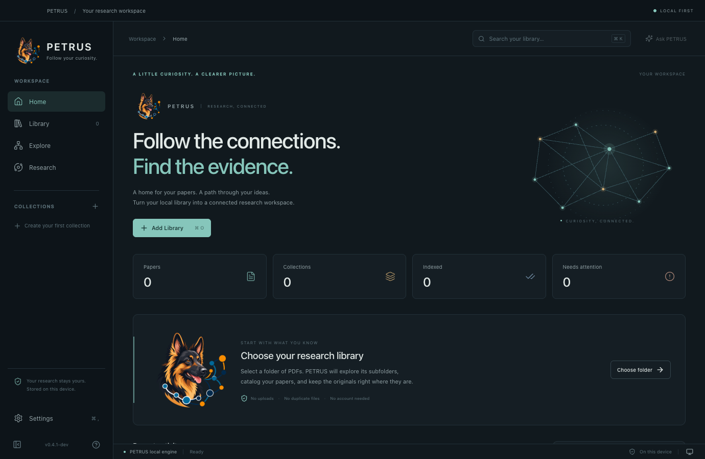

**English** · [Português (Brasil)](pt-BR/development-history.md)

> Historical development notes, preserved from the previous README on 2026-11-16. Package paths, status statements and commands below describe successive checkpoints and may be obsolete. Use the root README for current setup. / Notas históricas: caminhos e estados abaixo podem estar desatualizados.

# PETRUS

**Publication Evidence Tracking, Retrieval, Understanding & Synthesis**  
*Follow the connections. Find the evidence.*

Desktop local application to transform PDF folders into a searchable library. Current code 0.4.1-dev for macOS Apple Silicon, with Tauri 2, React/TypeScript, Rust, Python and SQLite. The provided logo was preserved in `app/src/assets/petrus-logo.png` and used in the interface and native icons.



## Open the checkpoint 0.3.0-dev package

The precompiled package remains at checkpoint 0.3.0-dev. To validate it with the separate database, execute in the project root:

```bash
env -u PETRUS_DEV_ENGINE \
  PETRUS_DATA_DIR="$PWD/.local-data/release-checkpoint-0.3c/package-smoke" \
  ./src-tauri/target/debug/bundle/macos/PETRUS.app/Contents/MacOS/petrus
```

This smoke directory is created by local validation. On another machine, provide your own test directory. Native manual validation and the package visual smoke were confirmed by the user; the report separates these from automated build and smoke confirmations of the sidecar.

This package includes the engine and the Python runtime. It does not require Python, Node, server or terminal during use. The current build is development for Apple Silicon, with ad hoc signing; it is not yet a notarized distribution by Apple.

On first run, click **Choose folder** and select a folder. Then use **Add Library** for other folders. The development library is not pre-configured in the product. Tests with real data use separate databases in `.local-data/`, ignored by Git. Opening the package normally uses the system's default data directory.

## Languages

English · Português (Brasil). Initial detection follows the system; manual selection in General / Geral is persisted. Scientific content remains in the source language.

## What is implemented

- Onboarding, Home, Library, Explore, Research, Settings and About.
- Native selector, multiple libraries, recursive discovery, background queue and progress.
- SHA-256, global deduplication and multiple locations per PDF; cache by size/mtime and explicit integrity verification.
- Rescan: new files, modified content, removed files and reconnected locations.
- SQLite with migrations, WAL, foreign keys and FTS5.
- Text per page, title, authors and DOI when found; conservative identification of abstract.
- Search by title, author, DOI, abstract and text. Filters by author, year, journal, collection and status; pagination of 100 records.
- Article panel, opening of the original PDF, reveal in the file system and persistent notes.
- Collection creation and manual association of articles.
- Cytoscape graph with directed citations, authors and collections; filters, legend, reference inspection and node navigation.
- Sessions with title, question, description, date and persistent creation event.
- System/Light/Dark themes, collapsible sidebar and native shortcuts `Cmd+K`, `Cmd+O`, `Cmd+,`.
- Scan on startup and watcher via 60-second polling, both optional and initially disabled.
- JSON logs with rotation; isolated basic parser with timeout.
- GROBID optional, hierarchical TEI parsing, references and exclusively local resolution.
- Structured Content / Pages, source spans and conservative page ranges.
- Scientific reprocessing per article or library in the existing queue.
- Larger original logo and reusable component `PetrusLogo` with size tokens.
- Hybrid lexical/semantic retrieval, EvidenceUnits with provenance and local embeddings index.
- Ask PETRUS in EN/PT-BR with clickable citations, strict validation and a single structural repair.
- Native LM Studio `/api/v1/chat`, separate OpenAI-compatible provider, explicit output/timeout controls and loopback-only integration.
- Optional semantic similarity in the graph, with indication that similarity does not demonstrate evidence.

Series 0.3 was concluded as development checkpoint 0.3.0-dev, with native manual validation and visual smoke of the package confirmed by the user. See [consolidated report 0.3](validation-0.3-final.md).

## 0.3.1-dev — LM Studio model selection

In **Settings → AI / Configurações → IA**, LM Studio providers use separate lists of **Chat model** and **Embedding model**. The catalog comes from `GET http://127.0.0.1:1234/api/v1/models`: availability, loading, and capabilities reflect the runtime and may change. Classification uses type metadata; models without recognized type remain in the unknown group. Missing fields do not receive invented values.

Selection is explicit, with no default model: choose and use **Save settings / Salvar configurações**. The exact ID is persisted. **Refresh models / Atualizar modelos** only re-reads the catalog, without saving or changing the selection and without downloading/loading models. If the server is closed or a model is missing, the configured ID remains visible as unavailable. **Custom model ID… / ID de modelo personalizado…** keeps the manual entry. OpenAI-compatible continues with manual ID and without LM Studio discovery.

**Save and check connection / Salvar e testar conexão** remains separate: saves the form and tests the chosen provider/model. Baseline Qwen 9B and defaults 1600 tokens / 90 s remain the same. No new Ask benchmark was executed.

To open the current code with the validation copy from this machine:

```bash
PETRUS_DATA_DIR="$PWD/.local-data/model-discovery-0.3.1/native-smoke" npm run desktop
```

On another machine, use your own test directory. See [model discovery validation](validation-0.3.1-model-discovery.md).

## 0.4c — Scientific Findings & Claims

In **Research → session → Findings / Achados**, use **New claim / Nova afirmação** to write a scientific claim and an optional note. Valid text is preserved exactly, without translation, summary, correction, or trim. No claims are generated by LLM. Limits: statement 10,000 characters, note 100,000; rejects empty text/only spaces and NUL characters.

**Add evidence / Adicionar evidência** lists only SavedEvidence from the same session. Manually select **Supports / Sustenta**, **Contradicts / Contradiz** or **Context / Contextualiza** and confirm **Link evidence / Vincular evidência**. These relations express the researcher's classification; there is no automatic semantic verification or truth score. The counts are descriptive.

The three dimensions are independent: evidence decision (Included/Excluded/Uncertain), relation (Supports/Contradicts/Context) and claim revision (Draft/Reviewed). The claim starts as Draft. **Reviewed by researcher / Revisada pelo pesquisador** requires at least one link and means only a human review, not scientifically verified truth or peer review. Removing the last source/link preserves the previous status and displays a warning. Going back to Draft is an explicit action.

Edit statement/notes with **Save claim**, alter relations explicitly and use **Archive claim / Restore claim** to archive/restore. Archived items stay out of the active list and in read-only mode until restored. All these changes have versions/transitions in the Research Trail. The Findings tab offers All/Draft/Reviewed/Archived filters; it is possible to navigate between claim, evidence and paper/PDF. The evidence also shows its related claims.

A link preserves fingerprint, SHA of paper/text, title/section/pages/provenance and reference to historical snapshot. Removing SavedEvidence does not delete the link; the source appears as removed, and historical text can be consulted when available. Reprocessing/unavailableing the source does not rewrite the snapshot. There is no automatic remapping of unit nor reconstruction of lost excerpt.

Isolated validation of this machine: `PETRUS_DATA_DIR="$PWD/.local-data/findings-claims-0.4c/native-smoke" npm run desktop`. See [report 0.4c](validation-0.4c-findings-claims.md).

## 0.4b — Research Trail

In **Research → session**, the tabs **Evidence / Evidências** and **Research Trail / Trilha de pesquisa** separate the current state from the history. The trail shows events in chronological order, local time, and actors **You / Você**, **PETRUS** and **System / Sistema**. Filter by actor, expand an event to load its details, and use the links to the evidence, article, or source event.

Choose **Choose target session / Escolher sessão-alvo** **before** sending a question in Ask to register the question, retrieval, and result in that session. Without a target session, Ask remains exploratory and does not create a session or trail. Retrieval does not save Evidence Cards: **Save evidence** remains an explicit action per card; **Save accepted answer to session** is a separate action. If the trail fails after Ask, a notice informs of the incomplete record without repeating the generation.

The trail preserves the final validated answer, exact versions of notes after **Save note**, decision transitions, and removed source identities. Rejected answer and technical failure have distinct events from insufficient evidence. It does not store reasoning, hidden prompts, raw server errors, or invalid candidates. Structural acceptance does not prove scientific support for each claim.

Previous sessions show only the events actually recorded and an incomplete history notice, with a single tracking start boundary. There is no retrospective reconstruction of questions/retrieval. SavedEvidence remains an independent snapshot; the trail is not event sourcing and does not reconstruct the workspace upon opening.

Isolated copy of this validation: `PETRUS_DATA_DIR="$PWD/.local-data/research-trail-0.4b/native-smoke" npm run desktop`. See [report 0.4b](validation-0.4b-research-trail.md).

## 0.4a — Scientific Evidence Workspace

In each Evidence Card in Ask, **Save evidence / Salvar evidência** allows choosing or creating a Research Session. The **Choose target session / Escolher sessão-alvo** control only selects the destination and confirms with **Use session / Usar sessão**. Nothing is saved automatically. The item starts as **Uncertain / Incerta**, even when the answer was accepted. Sources from a rejected answer can also be saved by human decision and are identified as **retrieved source**, distinct from sources of an accepted answer.

In **Research / Pesquisa**, open the session to review items, filter Included/Excluded/Uncertain, set your decision, write a **Research note / Nota do pesquisador**, and use **Save note / Salvar nota**. Decisions and notes are human: there is no automatic inclusion, exclusion, note filling, or synthesis by AI. It is possible to open paper details, go to the library, or open the PDF.

SavedEvidence is a **snapshot captured upon saving**, produced by the engine from the current verified EvidenceUnit. Reprocessing does not rewrite the saved excerpt, pages, or heading. An unavailable source keeps the snapshot visible. The fingerprint prevents duplicating the same source in the same session; different sessions can save the same evidence. IDs `E#` are local to the question; IDs `span:ID`, `section:ID`, and `chunk:ID` are not permanent global identities.

Removal registers a basic audit event before deleting the item. Altered decisions and notes also register events, without duplicating excerpts/notes or saving reasoning. This was the basic history of 0.4a; the full trail is implemented in 0.4b, described above. Details and limits in [validação 0.4a](validation-0.4a-evidence-workspace.md).

## Privacy and original files

PDFs are opened read-only and remain in the original location. The database stores paths, size, mtime, hash, metadata, and extracted text. Content is not sent to the internet. With GROBID enabled, the PDF is sent only to the parsing service in loopback. There is no account or telemetry. In the 0.3 series, embeddings and LLM are optional, with explicit configuration and loopback-only endpoints.

On macOS, files with the attribute `UF_DATALESS` are registered as unavailable locally without opening the content. To index them, make them available offline via OneDrive/iCloud and run **Rescan**. Hidden directories, temporary files, and internal symlinks are ignored. Permission failures are logged and the scan continues. An incomplete traversal does not mark unseen files as removed.

**Remove Library** removes the library link in the catalog, without deleting the PDFs. Already indexed content may remain in the database for reuse if the library is reconnected; articles without a registered location are removed from the listing and the graph. Removal is not a secure deletion operation of the indexed content.

## Development on macOS

Requirements: macOS with Command Line Tools (`xcode-select --install`), Node.js 22+, Python 3.11+ and stable Rust. The wrapper also detects Rust installed locally in `.tools/cargo` and `.tools/rustup`, as on this machine.

In a new checkout:

```bash
npm ci
python3 -m venv .venv
.venv/bin/python -m pip install -r engine/requirements-dev.lock
.venv/bin/python -m pip install -e engine --no-deps
.venv/bin/python scripts/package_engine.py
npm run desktop
```

The wrapper starts Vite and Tauri; Rust starts and shuts down the engine automatically. In development, the engine uses the Python code from `.venv`, even when a compiled sidecar exists next to the executable. Frontend changes have HMR; restart the application after changing the engine. Do not start another Vite on port 1420 before `npm run desktop`.

`npm run dev` opens only the frontend for visual development. The functional library requires `npm run desktop`.

### Generate the package

```bash
# Reempacotar o engine após qualquer alteração no Python ou nas migrations
.venv/bin/python scripts/package_engine.py

# Build de desenvolvimento com um .app autossuficiente
npm run desktop:build

# Build otimizado (fluxo disponível; ainda sem notarização)
node scripts/desktop.mjs build --bundles app
```

To regenerate icons from the original PNG:

```bash
npm run tauri -- icon app/src/assets/petrus-logo.png
```

The packaging script generates the sidecar with the Tauri target suffix. Compile the engine and the application on the target system and architecture. For Windows, the future flow uses Rust/MSVC, WebView2, Python on Windows and `--bundles nsis`. Windows and Linux have not yet been compiled or tested.

## Use optional GROBID on Mac

```bash
bash scripts/setup_grobid.sh  # preparação inicial; internet para dependências oficiais
bash scripts/start_grobid.sh  # terminal em primeiro plano, execução offline
```

Then, in **Settings → Indexing / Configurações → Indexação**, select GROBID, test `http://127.0.0.1:8070`, and reprocess the article or library. The basic fallback remains available. `.app` does not embed JVM/models and does not require Docker. See [docs/grobid.md](grobid.md).

## Tests and verifications

```bash
.venv/bin/python -m pytest engine/tests -q
.venv/bin/ruff check --config ruff.toml engine scripts
npm run lint
npm run build

# Com o frontend em outro terminal: npm run dev
npm exec playwright -- test
```

The interface tests use the **real Python engine with synthetic PDFs/TEI**; it only replaces IPC, folder selector, and operating system actions. By default, it uses the Chrome installed in the default path on macOS. Set `PETRUS_CHROME` to another Chromium executable. It does not use your real library in automated tests. See the scope and evidence in [docs/validation-0.2.md](validation-0.2.md). The historical record of 0.1 remains in [docs/validation.md](validation.md).

## Local data and diagnostics

On macOS, the default directory is `~/Library/Application Support/org.petrus.desktop/`. The exact path appears in **Settings → General**. It contains `petrus.sqlite3` and `logs/engine.jsonl` (5 MB, three backups). Logs may contain paths and PDF names; they remain on the computer. For local tests, `PETRUS_DATA_DIR` can point to another directory; it is not a necessary configuration for the user.

If a folder is disconnected, reconnect it and perform **Rescan**. If a PDF is password-protected, corrupted, empty, or exceeds parser limits, the other documents continue. If the engine terminates unexpectedly, restart the application. Interrupted jobs are identified at the start and can be resumed by a new scan.

## Limitations of this version

- pypdf is a basic parser. Title/authors may be missing or contain inappropriate editorial metadata. Journal and publication year remain unknown when reliable extraction is absent; the PDF creation date is not treated as the publication date. Abstract is a heuristic extraction.
- Locally extracted DOI is a candidate, without external validation. There is no query to Crossref, OpenAlex, or other services.
- The pypdf layer is limited to 300 pages and 100 thousand characters per page; no OCR. GROBID is optional and its metadata requires verification. Sections without reliable provenance keep unknown pages.
- Graph is limited to the 300 most recent articles, up to 2,000 links per author/collection type and 4,000 citations. Only resolved references generate `CITES`; author/collection do not imply citation or scientific agreement.
- Watcher is polling, not native events. Rescans rely on unchanged size/mtime; `verify_integrity` is the explicit operation to detect changes that preserve these attributes.
- Embeddings and local RAG are implemented and are optional. Ask PETRUS uses traceable sources, strict validation, and limited repair; structural acceptance does not replace human scientific evaluation. Providers operate only in loopback, with explicit selection in Settings → AI.
- Sessions have SavedEvidence and complete Research Trail; reports and synthesis remain out of scope.
- No automatic migration of references when folders are moved. Add the new location and remove the old one after the scan.

## Structure and evolution

```text
app/src/                 React, componentes, serviços e tokens de tema
src-tauri/src/           Shell Rust, menus, IPC e OSService
src-tauri/migrations/    Schema SQLite versionado
src-tauri/icons/         Ícones derivados do PNG original
engine/petrus_engine/    Banco, ingestão, parser, grafo e contratos de IA
engine/tests/fixtures/  PDFs sintéticos pequenos
scripts/                Execução e empacotamento do sidecar
tests/                  Fluxo de interface com engine real
docs/                   Arquitetura, modelo de dados, roadmap e validação
```

See [architecture](architecture.md), [database](database.md) and [roadmap](roadmap.md). The version 0.2 record is in [validation-0.2.md](validation-0.2.md). Internationalization: [i18n.md](i18n.md). The subsequent development of embeddings/Ask local is recorded below; external discovery agents and services remain out of scope.

## Development cleanup / Environment cleanup

Internal stage 0.2.1: RAG and provenance contracts are prepared in the engine; embeddings/RAG are not yet present. The `.app` 0.2 already validated was not recompiled in this stage.

Cleanup uses a fixed list of project destinations. **Default is dry-run**, even without a flag. Does not touch `.tools`, normal application data, PDF library, source, migrations, assets, documentation or screenshots. Rejects destinations containing symlinks or PDFs. Close development processes before removing anything.

```bash
bash scripts/clean.sh --dry-run build
bash scripts/clean.sh --dry-run validation
bash scripts/clean.sh --dry-run deep

# Somente após conferir o plano:
bash scripts/clean.sh --execute build
bash scripts/clean.sh --execute validation
# Deep exige as duas flags e inclui build + validation + node_modules + .venv:
bash scripts/clean.sh --execute --confirm-deep deep
```

`build` removes Tauri/frontend/PyInstaller outputs, generated sidecar and known test caches. Also removes the generated `.app`: rebuild before opening that path. `validation` removes only audit-named temporary folders, including PETRUS Validation.app; not `docs/validation*.md` or screenshots. Unknown future folders are not automatically included. See [space audit](development-cleanup-audit-0.2.1.md).

After deep cleanup, reinstall dependencies using existing locks:

```bash
npm ci
python3 -m venv .venv
.venv/bin/python -m pip install -r engine/requirements-dev.lock
.venv/bin/python -m pip install -e engine --no-deps
```

Recreate build artifacts with packaging/build commands above. Cleanup neither deletes nor reinstalls local GROBID, JDK or Rust.

## 0.3b development — local Ask PETRUS

Current source adds Ask PETRUS with clickable sources, bibliography filters, unit subdivision, diversity, section boost and semantic similarity. Run `npm run desktop` for the current engine. In **Settings → AI / Configurações → IA**, configure embeddings/local LLM separately with exact IDs. Generation stays disabled until model selection; no automatic downloads. Query expansion optional. Earlier `.app` still corresponds to its previously compiled version.

Scope/limits: [0.3b validation](validation-0.3b-arbovirus.md). Citations establish traceability, not scientific support for every sentence.
