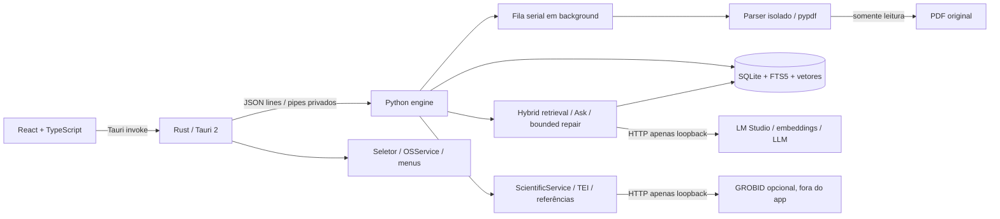

[English](../architecture.md) · **Português (Brasil)**

# Arquitetura do PETRUS

## CURRENT — 0.4.1-dev / Research Trail

Este bloco descreve o código atual. As seções de evolução abaixo registram o estado de cada etapa e seus limites históricos; afirmações antigas de “não implementado”, “reservado” ou “somente OpenAI-compatible” não se aplicam ao CURRENT.

- **Retrieval local operacional:** EvidenceUnits com IDs/provenance/páginas, subdivisão sem perda, embeddings em SQLite e busca híbrida FTS5 + similaridade por RRF. Configurações, thresholds, seleção e prompts foram congelados para a estabilização.
- **Ask PETRUS operacional:** pergunta em EN/PT-BR, fontes recuperadas, citações clicáveis e Evidence Cards, navegação à biblioteca/PDF; validação estrita de JSON/IDs/citações por parágrafo. Aceitação estrutural não comprova entailment científico.
- **Provider recomendado:** LMStudioNativeLLMProvider, loopback `POST /api/v1/chat`, baseline `qwen/qwen3.5-9b`, reasoning=off por capability. OpenAICompatibleLLMProvider usa `/v1/chat/completions` como opção separada; não é fallback automático.
- **Capability-aware reasoning:** capability com off envia off; presente sem off bloqueia; ausente omite o campo e aceita somente message final. Reasoning separado é descartado como conteúdo e retido somente como métricas/tipos, nunca como answer/reparo/research event.
- **Bounded repair:** uma geração original e no máximo um reparo estrutural com o mesmo contexto e sem novo retrieval. Saída inválida nunca é apresentada/salva como resposta. Falha técnica é distinta de abstinência científica validada.
- **Grafo:** CITES, SHARED_AUTHOR, SAME_COLLECTION, TITLE_SIMILARITY, SHARED_KEYWORDS, SHARED_REFERENCES e SEMANTIC_SIMILARITY estão implementados. Filtros derivados são opcionais; similaridade não é evidência científica.
- **Settings nativos:** temperatura 0,1; contexto 8192; defaults `llm_max_output_tokens=1600` e `llm_timeout_seconds=90`. Controles explícitos EN/PT-BR preservados, com validação backend. O probe 4B não mudou os defaults nem a escolha de modelo do usuário.
- **Embedding baseline validado:** `text-embedding-nomic-embed-text-v1.5`, 768 dimensões, `/v1/embeddings`. Não há reindexação nesta etapa; Ask usa o embedding da query pelo provider existente.
- **Descoberta de modelos (0.3.1-dev):** Settings usa `LocalModelSelect` para chat/embedding do provider LM Studio. A operação Rust permitida `llm_models` encaminha ao engine `llm/catalog.py`, que faz somente `GET /api/v1/models` em loopback HTTP, timeout 3 s, resposta limitada a 1 MB, sem proxy/redirect. Normaliza campos conhecidos e omite payload bruto; ausentes ficam null, tipo não reconhecido vira unknown. O helper `reasoning_capability` é compartilhado com o provider nativo; a política de inferência permanece igual. Refresh relê o runtime sem mutar SQLite/settings, seleção ou modelos. Estado só em memória do componente, sem cache persistente; respostas antigas são descartadas ao mudar endpoint/desmontar. Escolher um ID altera apenas o draft; Save e Save and check mantêm a semântica existente. IDs ausentes/offline e entrada customizada são preservados. OpenAI-compatible não usa a descoberta. Validação em [validation-0.3.1-model-discovery.md](validation-0.3.1-model-discovery.md).
- **Distribuição do checkpoint 0.3.0-dev:** macOS Apple Silicon, checkpoint de desenvolvimento com sidecar Python empacotado e assinatura ad hoc; sem publicação/notarização. A checagem manual nativa e o smoke visual do pacote foram confirmados pelo usuário; a recomendação CLOSE_0_3 está documentada em [validation-0.3-final.md](validation-0.3-final.md).

Histórico de validação: [9B bounded repair](validation-0.3b1c-ask-robustness.md), [comparação 4B](validation-0.3b1d2-nonconfigurable-reasoning.md). 4B permanece suportado; não é a baseline recomendada sob o orçamento validado.

## Workspace científico 0.4a (base preservada; histórico da implementação)

A UI acrescenta `SaveEvidenceDialog` ao Ask e `ResearchEvidenceWorkspace` ao detalhe de uma sessão. A sessão-alvo do Ask é uma escolha explícita em memória da UI; não foi criado setting global. A lista existente de sessões e seu cadastro são reutilizados. Novas operações `research_evidence_save/list/get/update/remove` estão na allowlist Rust e são atendidas por `ResearchEvidenceService`.

O handler `ask` do serviço continua chamando o mesmo `AskPetrusService`, com o mesmo retrieval/LLM/validator/reparo. Depois de obter a resposta, acrescenta um `response_id` opaco. Um registro volátil, limitado às últimas 16 respostas do processo, mantém somente pergunta, Evidence Cards e status final, sem resposta gerada ou reasoning. Esse recibo permite verificar qual unidade e rótulo local E# pertencem à pergunta, inclusive quando a geração falha. Após expirar/reiniciar o engine, um cartão ainda não salvo exige nova pergunta; evidências já salvas persistem normalmente. Um evento Ask já persistido também pode fundamentar a origem, com verificação de pertencimento. Não há salvamento automático de resposta, evento Ask ou evidência.

O salvamento reserva a transação SQLite (`BEGIN IMMEDIATE`), verifica sessão, unidade atual, paper, texto, provenance, páginas e papel da evidência; reconstrói os snapshots no engine. Quando há recibo/evento, verifica também o pertencimento à resposta. Campos arbitrários do frontend não podem virar trecho da fonte. A origem é derivada do status verificado: `ask_answer` para resposta aceita; `retrieved_source` nos demais casos com fonte recuperada. O rótulo E# nunca é uma chave global.

A migration `005_research_evidence.sql` cria o snapshot, FKs opcionais com SET NULL para fontes e unicidade por sessão/fingerprint. O hash canônico usa SHA do paper e do texto, páginas, provenance e identidade semântica de seção/fonte (heading, tipo, origem e offsets da subdivisão), sem depender dos IDs numéricos substituídos pelo parsing.

Decisão começa uncertain; somente update humano altera included/excluded/uncertain e user_note. A nota é preservada exatamente como recebida, sem trim/tradução/reescrita. A UI salva nota por botão, não a cada tecla. Updates sem mudança não geram evento. Snapshots não são editáveis pela operação de update. Eventos básicos guardam IDs, fingerprint, timestamp e transições de decisão; não replicam trechos/notas ou reasoning. Remoção faz evento e hard delete na mesma transação. Exclusão de sessão, se feita, segue o CASCADE já existente e remove itens/eventos; ainda não há operação de exclusão de sessão na UI.

Disponibilidade de fonte é projetada de paper_id e paper_files.available, conforme o catálogo local/último scan; não faz novo scan nem reprocessamento. Reprocessamento/exclusão de fonte não reescreve snapshots. Não foi implementado detector de fonte alterada nem remapeamento automático de IDs. As ações de fonte usam o paper atual quando disponível; caso contrário o snapshot permanece visível. Não há síntese, findings/claims ou Research Trail completo nesta etapa.

## Research Trail 0.4b

`research_evidence` continua autoridade do estado atual. O histórico usa a mesma tabela `research_events`, evoluída pela migration 006. `trail.py` centraliza escrita canônica, projeção compacta paginada e detalhes sob demanda. A UI `ResearchSessionWorkspace` mantém o workspace 0.4a na aba Evidence e acrescenta `ResearchTrail`, com filtros de ator e links. `research_trail_list/get` estão na allowlist Rust. Não há segundo log, replay, event sourcing global ou mutação sugerida por IA.

O seletor de sessão-alvo aparece antes da pergunta e é uma escolha explícita da UI, sem setting global. `ask` sem sessão conserva o comportamento exploratório. Com sessão válida, grava `question_asked`, executa o mesmo Ask e grava recuperação + resultado em uma transação curta posterior. Não mantém SQLite aberto durante a geração. Uma falha posterior retorna `trail.state=failed` com aviso localizado; a resposta Ask continua disponível, sem nova geração para tentar registrar a trilha. Se uma exceção impedir concluir o Ask, um evento técnico seguro representa a falha; uma interrupção abrupta pode deixar só a pergunta, sem resultado fabricado.

A observação envolve a instância do retriever existente: intercepta seus retornos e não faz retrieval, embedding ou geração extras. Registra QueryPlan, configurações vigentes, identidades/hashes das unidades selecionadas, ranks e scores observados e contagens retornadas por fonte. `returned_candidate_count` é a quantidade retornada, limitada a 30, não o tamanho irrestrito do universo de candidatos. `max_hits_per_paper=2` descreve a preferência de diversidade existente, que pode completar vagas com excedentes; não promete um teto absoluto. Se o core usar seu fallback lexical interno, os ranks desse outro retriever não são observados: a trilha informa `ranking_observed=false`, estratégia lexical_fallback e campos desconhecidos, sem repetir busca para inventar números. Falha de observação também não deve transformar retrieval bem-sucedido em fallback. Não há trechos completos no evento retrieval; o hash do contexto é calculado sobre identidades/QueryPlan/configuração, não sobre prompt oculto.

A política de atores é: criação explícita de sessão, pergunta, save manual de resposta e ações de evidência são `user`; resposta final aceita e abstinência validada do LLM são `ai`; retrieval, rejeição, falha técnica e fronteira são `system`. Ausência de fonte (`no_evidence`) gera abstinência de sistema, sem atribuir uma geração inexistente à IA. O antigo tipo `ask` continua representando o save manual, projetado como `ask_saved_to_session`, sem evento paralelo equivalente.

A resposta aceita contém snapshot final e citações revalidadas. Rejeição/falha guardam apenas códigos técnicos permitidos e resumo da execução. Não há reasoning, prompts, candidatos inválidos ou mensagens brutas de erro nos eventos. O recibo volátil continua limitado a 16 perguntas/seleções/status e acrescenta somente o ID do resultado persistido. Um save explícito pode referenciar esse resultado; após perder o recibo, uma origem persistida é verificada por identidade, texto SHA e, quando conhecidos, paper SHA/fingerprint. Isso não remapeia automaticamente unidades reprocessadas.

Notas conservam deliberadamente cada nova versão exata após Save note e mudança real, com hash anterior/novo; não capturam digitação. Save/update/remove e seus eventos compartilham transação. Um save novo preserva uma cópia histórica durável da fonte; remove referencia esse evento e preserva identidade, título, seção, páginas e decisão. Na remoção de um item legado cujo save antigo não tinha trecho, captura o snapshot existente naquele momento em um novo evento. Nunca reescreve o passado. Eventos antigos não permitem recuperar versões de notas que não foram guardadas.

Eventos são imutáveis por API e triggers SQLite; correções viram novos eventos. A política FK CASCADE de exclusão de sessão é preservada, embora não exista ação de excluir sessão nesta UI. UTC é persistido e apresentado no fuso local; `(created_at ASC, id ASC)` define a ordem determinística. Abrir/reabrir é somente leitura do histórico; a migration insere a fronteira uma única vez para sessões preexistentes.

## Findings / ResearchClaim 0.4c

`claims.py` adiciona um domínio humano ao lado do workspace/trilha: `research_claims` é estado corrente da afirmação e `research_claim_evidence` é estado corrente dos vínculos. Findings é o nome da área, não uma terceira entidade. O engine é a autoridade de validação; as nove operações `research_claim_*` estão na allowlist Rust. Nenhum código de Ask/retrieval/embeddings/LLM/grafo é alterado ou chamado pelo domínio.

Statement e researcher_note são strings humanas exatas, com limites 10.000/100.000 caracteres; não há trim do valor válido. Claim inicia draft. reviewed exige ao menos um vínculo persistente, inclusive um vínculo histórico cuja fonte foi posteriormente removida: é uma regra mínima de organização, não verificação de suporte semântico. Ações sobre fonte, relação ou texto não promovem/rebaixam status automaticamente. Reviewed sem vínculos ou com alguma fonte removida/indisponível mostra aviso. Archive/restore preserva texto/status/vínculos; arquivadas são somente leitura e podem ser acessadas pelo Trail ou filtro Archived.

Vínculos só são aceitos para SavedEvidence da sessão proprietária da claim, derivada no engine, reforçada por triggers. `UNIQUE(claim_id,evidence_fingerprint)` impede duplicação mesmo após substituição de IDs. Repetir link retorna o vínculo existente sem mudar sua relação; a mudança exige evidence_update. Se uma fonte removida for salva novamente com o mesmo fingerprint, não se remapeia silenciosamente: o pesquisador pode desvincular e vincular de novo explicitamente. Unlink remove o vínculo corrente, preservando seu evento histórico; remover SavedEvidence usa SET NULL e mantém o vínculo corrente com metadata estável.

O vínculo guarda identidade e metadados, não duplica obrigatoriamente texto. Primeiro procura snapshot durável compatível por fingerprint, SHA/texto/paper nos eventos existentes da sessão. Fontes 0.4b normalmente reutilizam evidence_saved. Um item legado sem texto histórico ganha snapshot no primeiro claim_evidence_linked explícito, sem fabricar evidence_saved retroativo. Vínculos posteriores reutilizam essa referência. O snapshot é consultado sob expansão explícita via research_trail_get; não há reprocessamento ou reconstrução. Campos de metadata/SHA/páginas do vínculo não são reescritos quando a fonte muda.

Cada mutação reserva BEGIN IMMEDIATE e emite eventos canônicos user/v1 dentro da mesma transação: claim_created, claim_statement_updated, claim_note_updated, claim_review_status_changed, claim_evidence_linked, claim_evidence_relation_changed, claim_evidence_unlinked, claim_archived e claim_restored. As versões iniciais e novas de statement/nota, hashes e transições permitem reconstrução do histórico sem editar eventos antigos. Nenhum reasoning integra os payloads. Reads não criam eventos; no-ops não alteram timestamps/histórico. Falha no evento reverte a mutação inteira.

A UI `Findings` é a terceira aba de `ResearchSessionWorkspace`, preservando Evidence/Research Trail. Usa formulários explícitos, seletor de fontes da sessão, filtros/contagens ativas e navegação bidirecional. `ResearchEvidenceService.row` projeta IDs/status de claims relacionadas sem modificar os snapshots salvos. O Trail acrescenta detalhes de versões e link para a claim inclusive arquivada. Statement/nota e trechos são renderizados como texto escapado, sem tradução automática. Não há síntese, export, grafo de claims ou avaliação automática.

## Fronteiras



Não há listener HTTP nem porta do engine Python. O adapter científico faz requisições HTTP de saída para GROBID em loopback quando habilitado; providers de embeddings/LLM também usam exclusivamente loopback e configuração explícita. `engine_call` valida uma lista de operações no Rust; cada requisição JSON possui um número de sequência e uma resposta. O mutex do transporte mantém a correspondência entre pedidos e respostas. A fila de ingestão é uma thread separada no Python, portanto pedidos de status e pesquisa continuam disponíveis durante o scan. O frontend consulta o estado a cada 1,6 segundos.

O protocolo é pequeno e substituível por outro transporte no futuro. No MVP, o engine possui o banco, as migrations, a extração e a pesquisa; o Rust possui a integração com o SO e o ciclo de vida. Isso evita que duas camadas implementem o mesmo schema e permite reutilizar o core científico no Windows.

## Ciclo de vida

O shell inicia um processo Python único ao abrir. Em desenvolvimento, `scripts/desktop.mjs` define `PETRUS_DEV_ENGINE=1` e o shell usa a `.venv`. No pacote, executa o sidecar PyInstaller ao lado do binário principal, incluindo o runtime Python e as migrations.

No encerramento, o Rust fecha o stdin do engine. O Python cancela o parser ativo e sinaliza a fila. O Rust espera brevemente o encerramento e aplica término forçado como fallback. Uma interrupção abrupta é recuperável pelo SQLite; na próxima abertura, jobs em andamento são marcados como interrompidos e podem ser reescaneados. Não se promete retomada no byte/página exata.

O parsing básico usa subprocessos com timeout de 60 segundos, sem requisições de rede. O parsing científico usa HTTP exclusivamente em loopback, com timeout próprio de 60 segundos. Uma falha de parser não derruba o scanner. A fila é serial para limitar uso de CPU/memória em notebooks. Não há cancelamento manual de scan nesta versão.

## Ingestão e identidade

`discover_pdfs` usa `os.walk`, preserva Unicode e espaços, não segue symlinks internos e ignora diretórios ocultos e temporários. Erros de travessia são registrados. O scan tem etapas `discovered → hashing → metadata → text_extraction → indexed`, e cada job guarda total, concluídos, erros e último arquivo.

Cada conteúdo possui um SHA-256 único em `papers`. A tabela `paper_files` registra uma ou mais localizações físicas, com biblioteca, path, tamanho, mtime em nanossegundos, disponibilidade, erro e token do scan. Arquivos cloud-only podem ser registrados sem `paper_id`, pois não há hash sem leitura. Seus nomes e erros aparecem na lista de atenção.

Rescans reutilizam o hash de localizações com tamanho/mtime inalterados; `verify_integrity` força o recálculo. Tamanho/mtime também detectam mudanças durante a leitura. A identidade canônica continua sendo SHA-256. O arquivo é verificado antes/depois do hashing e após o parsing. Conteúdo já pronto não é extraído novamente. Um conteúdo alterado ganha um registro próprio; o vínculo da localização passa para ele. Conteúdos antigos ficam retidos no banco, sem aparecer na biblioteca quando não possuem mais localização cadastrada.

Após uma travessia completa, localizações não vistas são marcadas como indisponíveis. Se houver falha de travessia, essa marcação é omitida para evitar declarar removido um arquivo em diretório inacessível. Uma pasta raiz indisponível produz um job com erro e preserva o catálogo.

## Parsing e qualidade de metadados

`PdfParser` define `parse_metadata`, `extract_text`, `extract_pages` e `extract_references`. `SimplePdfParser` implementa pypdf. A implementação básica não extrai referências; `GrobidPdfParser` fornece o resultado científico, com seções hierárquicas e referências, e reutiliza a camada de páginas do pypdf.

DOI: procurar em metadados, primeira página e restante do texto; normalizar prefixos/capitalização e pontuação terminal. O candidato não é confirmado externamente. Título usa metadados ou nome do arquivo; autores vêm do campo de metadados. Abstract usa uma heurística marcada na documentação. Ano e periódico permanecem desconhecidos quando a informação não é confiável. Não confundir `CreationDate` com publicação.

Há limites de 300 páginas, 100 mil caracteres por página e conteúdo de página acima de 20 MB sinalizado como warning. Esse limite de conteúdo é aplicado após descompressão; o processo separado contém falhas de parser e excesso de memória, sem prometer um teto rígido de memória do processo. OCR ainda não foi implementado.

## Persistência e pesquisa

SQLite em WAL, `foreign_keys=ON`, timeout de lock e conexões curtas por thread. Migrations são transacionais e registradas em `schema_migrations`. FTS5 indexa título, autores, DOI, abstract e texto extraído. Consultas são parametrizadas; a busca gera termos Unicode escapados com correspondência de prefixo e combinação AND. Não executa sintaxe FTS fornecida pelo usuário.

## Grafo e expansão

O grafo combina citações resolvidas, coleções, nomes de autores, relatedness determinística e similaridade semântica opcional por embeddings locais. Cada relação possui tipo próprio, e somente citações possuem direção. Coincidência de nome não resolve identidade de pessoas; dois autores homônimos podem criar um vínculo. Não há inferência de evidência científica a partir desses vínculos. O grafo limita nós/vínculos para manter a navegação responsiva.

Referências, seções e source spans são derivados do TEI local. `CITES` deriva exclusivamente de resolução local confirmada, sem usar fuzzy candidates como arestas. Retrieval semântico, Ask e SEMANTIC_SIMILARITY estão operacionais por opt-in local. Evidence Cards preservam artigo, seção, trecho, provenance e página quando conhecida; unidades não paginadas não recebem página inventada. Providers remotos não são suportados. O estado inicial sem RAG operacional é preservado no histórico incremental abaixo.

## Integração com o sistema

`OSService` abre PDFs por app padrão e revela o arquivo no Finder/Explorer; Linux abre a pasta pai. Recebe um ID de paper e resolve caminhos cadastrados no engine. Nenhum shell interpreta os nomes dos arquivos. `Path`/`PathBuf` compõem caminhos. O seletor usa o plugin oficial de diálogo Tauri, com capability restrita à janela principal. A interface renderiza texto de PDFs como texto escapado.

System/Light/Dark são persistidos no SQLite. O tema System acompanha o SO. Menus nativos preservam operações de edição e atalhos de busca/pasta/configurações. Assets e fontes são locais. O único servidor de desenvolvimento é Vite; ele não participa do pacote distribuído.

Referências técnicas: [Tauri: estado gerenciado](https://v2.tauri.app/develop/state-management/), [Tauri: sidecars](https://v2.tauri.app/develop/sidecar/), [pypdf](https://pypdf.readthedocs.io/) e [SQLite FTS5](https://sqlite.org/fts5.html).

## Histórico incremental — decisões da 0.2

As seções datadas seguintes descrevem o código e a validação **naquele checkpoint**. Mudanças posteriores prevalecem; consulte CURRENT para o estado atual.

`002_scientific_parsing.sql` estende o schema; a migration 001 é preservada. `paper_basic_metadata` retém os metadados básicos anteriores e `parser_runs` guarda tentativas, TEI e warnings locais. `ScientificService.replace` substitui seções, referências e seus spans numa única transação, mantendo chunks/páginas e notas. Uma falha posterior conserva a última estrutura válida, sinalizada com aviso.

`GrobidService` controla estados unavailable/available/running/error. Não instala nem inicia JVM automaticamente. O serviço local opcional tem configuração própria; detalhes e limites em [grobid.md](grobid.md). `FileAvailabilityProvider` separa a política macOS UF_DATALESS do scanner, com fallback genérico para outras plataformas.

As seções preservam headings da fonte e usam categorias canônicas determinísticas. Coordenadas válidas têm preferência; caso contrário, só ocorrências textuais únicas são alinhadas a páginas. Spans podem existir mesmo quando o intervalo completo da seção é desconhecido. Uma seção com partes não mapeadas mantém page_start/page_end NULL.

Resolução local prioriza DOI normalizado e único, depois título normalizado exato com comprimento mínimo. DOI conflitante, título curto ou ambiguidade impedem resolução automática. Similaridade de título cria somente candidate. Não há matching definitivo por autor/ano. O grafo distingue CITES (direcional), SHARED_AUTHOR e SAME_COLLECTION. Os campos de exibição históricos do grafo são mantidos por compatibilidade; `type` contém o código canônico.

A UI usa i18next e os mesmos catálogos são compilados no Rust para menus. Preferências `system/en/pt-BR` são independentes do tema. `PetrusLogo` centraliza variantes e preserva o PNG e sua proporção. O contrato OSService recebe a página solicitada e informa que o aplicativo padrão não oferece abertura portável em página; não há automação de teclas ou edição do PDF.

Veja [i18n.md](i18n.md) para regras de copy e conteúdo científico.

## RAG foundation — etapa interna 0.2.1

> Histórico 0.2.1: preparação de contratos antes dos providers operacionais da 0.3.

Fluxo preparado: **PDF → section → source span → EvidenceUnit → future embedding → future retrieval**. `rag/evidence.py` projeta unidades diretamente do SQLite, sem duplicar texto ou criar índice. Spans conhecidos são preferidos; seções parcialmente mapeadas também preservam seu texto completo para descoberta, sem alegar páginas. A camada básica é fallback para artigos sem estrutura/spans.

| ProvenanceLevel | Origem | Política de uso futuro |
|---|---|---|
| `coordinate` | `grobid_coordinates` | Pode sustentar evidência paginada, com source span e página |
| `exact_page_alignment` | `page_text_alignment` | Pode sustentar evidência paginada, com source span e página |
| `section_only` | Seção sem span confiável completo | Descoberta/contexto; páginas da unidade permanecem NULL |
| `basic_page_text` | Chunk da camada pypdf | Fallback/exploração, sem promoção a evidência científica estruturada |

`supports_paginated_evidence` formaliza a política. IDs `span:ID`, `section:ID` e `chunk:ID` identificam registros **do banco atual**: reprocessamento substitui linhas, portanto um índice futuro deverá invalidar/reconstruir suas entradas. Não são identificadores globais permanentes. `subdivide_span` é uma fronteira identidade, sem cortes arbitrários; futuras subdivisões deverão preservar paper, section, source span, páginas e provenance.

`rag/contracts.py` define somente `EmbeddingProvider` (provider/model/dimension, documentos e query), `RetrievalQuery` e `RetrievalHit` (EvidenceUnit + score). `VectorIndex` e `LLMProvider` existentes permanecem inalterados. Não há modelos, tokenizer, chamadas de rede, embeddings ou retrieval operacional.

Migration 003 acrescenta listas JSON em `papers.scientific_warning_codes` e `parser_runs.warning_codes_json`; mensagens/chaves de apresentação existentes são preservadas. Códigos atuais: `page_mapping_partial`, `page_mapping_missing`, `grobid_invalid_response`, `grobid_timeout`, `grobid_unavailable`, `grobid_failed`, `pdf_size_limit`, `file_unavailable`, `rescan_required`, `file_changed`. Não há código especulativo de incerteza de metadados nem distinção inventada para tamanho TEI: o adapter 0.2 agrupa essa falha com resposta inválida. Backfill usa somente chaves antigas conhecidas e estrutura atual; tentativas históricas sem informação suficiente permanecem com lista vazia. Nenhuma mensagem humana é interpretada.

## Graph relatedness — etapa interna 0.2.2

> Histórico 0.2.2: SEMANTIC_SIMILARITY era reservada; foi implementada na 0.3b.

`RelatednessService` calcula relações locais sob demanda para os artigos visíveis no grafo, sem migration ou persistência de novas arestas. Unicode/casefold, pontuação, stopwords EN/PT e tokens curtos/genéricos são normalizados deterministicamente.

- `TITLE_SIMILARITY`: Jaccard ponderado por IDF **somente dos títulos**; pelo menos 3 termos compartilhados e score ≥ 0,65.
- `SHARED_KEYWORDS`: termos derivados de título + abstract, explicitamente `derived_term`, pois o parser atual não expõe keywords do artigo. Seleciona até 12 termos por artigo por IDF; em corpus de pelo menos 5 artigos, exclui termos presentes em mais de 60%. Exige 3 compartilhados e Jaccard ponderado ≥ 0,20.
- `SHARED_REFERENCES`: bibliographic coupling por DOI normalizado ou, quando ausente, título normalizado exato com pelo menos 30 caracteres e 5 palavras. Referências não precisam estar resolvidas localmente. Deduplica identidades por artigo; exige 2 referências compartilhadas e Jaccard ≥ 0,05. Não usa raw citation nem fuzzy matching; DOI e identidade apenas por título não são unificados por inferência.

Índices invertidos geram pares únicos; postings acima de `max(40, 25% do corpus)` não geram candidatos. Scores são 0–1, com razões em metadata: até 10 termos ou 5 exemplos de referências. Mantém no máximo 300 arestas por tipo e grau 6 por artigo/tipo, priorizando score e IDs para desempate determinístico. Esses limites privilegiam legibilidade e podem omitir relações; scores dependem do corpus visível, não são uma medida científica universal.

Os três filtros começam desligados; somente citações começam ligadas. Relações derivadas são não direcionais, tracejadas, inspecionáveis e acompanhadas de aviso: similaridade/informações compartilhadas não demonstram evidência científica, causalidade ou concordância. CITES persistida continua separada. A lista opcional Related papers no detalhe fica para depois.

`SEMANTIC_SIMILARITY` está apenas reservada no enum/tipo para **0.3**. Nenhum embedding, LLM, índice vetorial ou RAG foi implementado. Verificação 0.2.2: 8 testes novos + 2 regressões do grafo passaram (10 em 0,75 s), Ruff e TypeScript/ESLint dos arquivos alterados passaram. Não houve build completo, teste visual/Playwright ou processamento da biblioteca real.

## 0.3a — Hybrid retrieval

> Histórico 0.3a: Ask e semantic graph foram implementados posteriormente, na 0.3b; o pacote atual é tratado no relatório 0.3c.

**EvidenceUnit → EmbeddingProvider → SQLiteVectorIndex → semantic retrieval**, junto a **FTS5 → RRF → hybrid retrieval**. Embeddings são derivados/reconstruíveis, nunca fonte de evidência: provenance e `supports_paginated_evidence` continuam no EvidenceUnit. Não há geração LLM/chat.

Migration 004 cria `embedding_index`: float32 little-endian BLOB, dimensão, hash, paper/unit/provider/model, timestamps e unicidade unit/provider/model. NumPy calcula cosine em matriz, sem índice externo ou cache permanente em RAM. Cache usa hash do texto e identidade/provenance/metadados; busca ignora linhas stale imediatamente e `remove_stale()` as remove. Providers/modelos têm índices independentes; provider ID inclui endpoint. Se os pesos mudarem sob o mesmo identificador, usar `EmbeddingIndexService.clear()` e reindexar explicitamente.

`EmbeddingIndexService` oferece `index_paper`, `index_all_available`, `remove_stale`, `status` e `clear`. É síncrono e explícito; só considera papers disponíveis no catálogo, sem abrir PDFs. Unidades acima de `embedding_max_chars` (padrão 6.000) são puladas com `embedding_unit_too_large` retornado na operação, sem truncamento ou histórico adicional. O limite em caracteres deve ser adequado ao contexto do modelo; tokenizer/subdivisão ficam para 0.3b.

O provider real usa HTTP `POST /v1/embeddings`, somente loopback, sem proxies/redirects/SDK OpenAI. `localhost` conecta diretamente a 127.0.0.1. Timeout 30 s, resposta máxima 16 MB; valida modelo, ordem/quantidade, dimensão e vetores finitos/não nulos. Não baixa modelos. Autenticação do servidor local não foi adicionada.

FTS5 existente (`paper_search`) mantém BM25 por paper; overlap lexical escolhe suas EvidenceUnits, sem novo índice FTS por trecho. Hybrid funde até 30 candidatos por fonte por RRF `1/(60+rank)`, sem somar scores crus; empates usam unit ID. Sem provider/índice, hybrid opera lexicalmente; falha HTTP com índice ativo retorna erro explícito.

**Configuração pela API:** `embedding_provider="lmstudio"`, `embedding_endpoint="http://127.0.0.1:1234/v1"`, `embedding_model="IDENTIFICADOR_EXATO_DO_MODELO"`, `embedding_max_chars=6000`. O padrão é provider `none`; endpoint padrão só é escolhido para LM Studio. No LM Studio, disponibilizar um modelo de embeddings, iniciar o servidor na seção Developer e copiar seu identificador exato, mantendo acesso local. São instruções para o usuário: nenhum modelo/servidor real foi executado nesta validação. [Servidor local oficial](https://lmstudio.ai/docs/developer/core/server).

Operações JSON-lines do engine (também na allowlist Rust):

```json
{"id":1,"method":"save_settings","params":{"embedding_provider":"lmstudio","embedding_endpoint":"http://127.0.0.1:1234/v1","embedding_model":"IDENTIFICADOR_EXATO_DO_MODELO","embedding_max_chars":6000}}
{"id":2,"method":"embedding_index","params":{"paper_id":1}}
{"id":3,"method":"embedding_status","params":{}}
{"id":4,"method":"semantic_search","params":{"query":"genomic surveillance","top_k":10}}
{"id":5,"method":"hybrid_search","params":{"query":"genomic surveillance","top_k":10}}
{"id":6,"method":"embedding_remove_stale","params":{}}
```

Buscas retornam `hits` com EvidenceUnit completo, paper/title, excerpt (prévia de 600 caracteres, sem alterar texto indexado), score, ranks lexical/semantic/hybrid e política de evidência. Não há filtro de coleção, nova UI ou fila de embeddings. `index_all_available` existe somente como operação explícita do serviço Python; não é disparado automaticamente.

Validação: **20 testes passaram em 0,80 s** (14 novos + 5 foundation + 1 migration); Ruff passou. FakeEmbeddingProvider e transporte HTTP simulado permitem testes offline. NumPy 2.5.4 é a única dependência runtime acrescentada e está no lock. Sem LM Studio real, biblioteca real, Playwright, TypeScript (UI inalterada), build Tauri ou nova validação completa. O `.app` 0.2 permanece sem recompilação. Semantic graph/representação de paper, Ask PETRUS, geração LLM, evidence citations e reranking ficam para 0.3b.

## 0.3b — Evidence-aware retrieval e Ask PETRUS

> Histórico 0.3b inicial: este transporte chat antecede o provider nativo da 0.3b.1b e bounded repair da 0.3b.1c.

`EvidenceUnit.evidence_role` é uma projeção determinística da seção/ancestrais: body, abstract, methods, results, discussion, conclusion, limitations, metadata ou bibliography. Spans ligados diretamente a references são bibliografia ou marcadores isolados no TEI atual; o parágrafo de corpo que discute uma citação continua representado pelo span de sua seção. Retrieval exclui bibliography/metadata por padrão, com `include_bibliography=true` explícito para descoberta. Os registros originais não são apagados.

`subdivide_span(max_chars)` particiona sem overlap nem perda de caracteres: parágrafos, sentenças, fallback por caracteres. Children `:part:N` retêm parent/source span, seção, páginas, provenance, papel e offsets relativos ao texto pai. O limite global participa da projeção; hashes incorporam identidade/provenance/papel/partes, invalidando vetores antigos. Não há migration adicional.

`QueryPlan` retém a pergunta e normaliza apenas para idioma/intenção heurísticos EN/PT. RRF permanece k=60 e 30 candidatos/fonte. Método/resultado/limitação recebem boost 1,15 quando coincidem com o papel derivado. Score bruto é preservado em cada hit; `section_boost` explicita o multiplicador. A diversidade final prioriza um hit por paper, depois até dois; somente preenche com excedentes se faltarem papers para completar K. Tradução/expansão por LLM local é opcional, desligada por padrão: queries original e até três expansões entram no RRF; falha conserva o original.

O novo provider chat usa somente loopback `/v1/chat/completions`, HTTP simples sem tools, proxy, redirect ou SDK externo. Settings independentes `llm_provider/endpoint/model/temperature`, padrão none/0,1; `llm_status` verifica modelo servido e resposta mínima sem papers. Não escolhe modelos automaticamente.

`AskPetrusService` recupera 30, remove bibliografia/metadados, prefere provenance paginada, deduplica trechos por Jaccard de shingles de quatro palavras (≥0,92) e seleciona até oito unidades. Contexto de evidências serializado limitado a 12.000 caracteres; fontes inteiras dentro dessa seleção, sem cortar silenciosamente a unidade. System prompt limita resposta às fontes, trata conteúdo como dado não confiável e exige incerteza, abstinência e IDs [E#]. JSON malformado, IDs desconhecidos ou parágrafos sem citação são rejeitados. Sem fonte elegível, usa a mensagem de evidência insuficiente; sem modelo configurado, informa que é necessário selecionar um LLM e pode mostrar as fontes recuperadas. Validação de IDs não demonstra entailment científico: não existe garantia automática de que uma frase citada é sustentada pela fonte.

API: `ask`, `llm_status`, `save_ask_event`. Research Session existente recebe snapshot JSON da pergunta/resposta/evidências/modelo/metadados, com timestamp da tabela research_events. A UI Ask é uma página de pergunta/resposta e cards, sem chat contínuo; citações destacam cards. Abrir PDF mantém a limitação portável de página do OSService. Settings → AI separa Embedding e LLM.

SEMANTIC_SIMILARITY usa centroides normalizados de até 12 vetores atuais por paper, com prioridade abstract/body/methods/results/discussion/conclusion e exclusão de bibliografia/metadados. Compara em blocos de 128, threshold fixo 0,85, até seis vizinhos por paper e 300 arestas; corpus do grafo continua limitado a 300 nós. Mesmos provider/model/dimensão e hashes atuais são obrigatórios. Filtro começa OFF; semelhança não implica concordância ou evidência científica. Os thresholds das três relações 0.2.2 não mudaram.

Relatório real limitado aos dez papers conhecidos, sem avaliação humana exigida: [validation-0.3b-arbovirus.md](validation-0.3b-arbovirus.md). Não houve geração real porque três modelos de chat estavam disponíveis sem escolha inequívoca; o fluxo gerador foi validado com FakeLLMProvider. O app empacotado anterior não foi reconstruído nesta etapa; usar o código de desenvolvimento para os novos fluxos.


## 0.3b.1b — LM Studio REST v1 nativo

> Histórico 0.3b.1b: a ausência de retry descrita aqui foi substituída por bounded repair na 0.3b.1c; a negociação de reasoning foi atualizada na 0.3b.1d.2.

`llm_provider="lmstudio"` usa `LMStudioNativeLLMProvider` via `POST /api/v1/chat` e catálogo `GET /api/v1/models`. HTTP apenas loopback, sem proxy/redirect/SDK ou integrações/tools. Configuração interna padrão: reasoning off, contexto 8192, temperatura 0,1, max_output_tokens 1600, store false e stream false. Não usa response_format, chat_template_kwargs ou previous_response_id. O endpoint base é `http://127.0.0.1:1234`; URLs antigas terminadas em /v1 continuam aceitas e são normalizadas em memória apenas para chat. Embeddings conservam /v1/embeddings e seu índice. Não há migration SQL nem escrita automática de configurações legadas.

Somente itens output[].type=message entram no conteúdo final; múltiplos segmentos message são unidos em ordem com duas quebras de linha, comportamento previsto pela API nativa. Reasoning/tool output são ignorados. Sem message útil: llm_empty_response. Metadados retêm somente tipo de output, instance ID, status, tamanho do content e métricas numéricas permitidas; reasoning nunca é persistido ou inserido em research_events.

O prompt existente solicita JSON; o engine exige answer:string, insufficient_evidence:boolean e limitations:string[], além das validações de citação. Campos adicionais de metadados são ignorados, preservando a compatibilidade do validador com AskResponse/eventos. JSON inválido, fences e marcadores de citações fora do contrato são recusados, sem reparação ou retry automático. A aceitação estrutural não demonstra entailment.

`OpenAICompatibleLLMProvider` permanece intacto como classe/rota de transporte separada, selecionável por `llm_provider="openai_compatible"`, endpoint loopback /v1. A opção none continua sendo o default global; nenhum modelo é escolhido automaticamente. A UI diferencia os providers, sem expor reasoning/contexto ou mudar o fluxo Ask.

Contrato nativo conferido na [documentação oficial de chat](https://lmstudio.ai/docs/developer/rest/chat) e [catálogo](https://lmstudio.ai/docs/developer/rest/list). Resultados e limites reais em [validation-0.3b1b-lmstudio-native.md](validation-0.3b1b-lmstudio-native.md).


## 0.3b.1c — Bounded repair do contrato Ask

O Ask gera um candidato e aplica o mesmo validador estrito antes de qualquer apresentação/salvamento. AskValidationError distingue invalid_json, missing_required_field, wrong_field_type, invalid_citation_syntax, missing_citation, paragraph_without_citation e unknown_evidence_id, preservando códigos públicos existentes. Somente defeitos estruturais reparáveis permitem uma segunda geração de FORMAT/CITATION REPAIR ONLY. A pergunta, idioma e seleção serializada de EvidenceUnits permanecem idênticos; retrieval/seleção não são repetidos. Saída anterior e conteúdo do usuário entram como dados não confiáveis no segundo request. Não há conserto programático de JSON/citações nem terceiro candidato.

Timeout/HTTP/provider, resposta vazia, IDs fora do contexto e indicadores explícitos de violação de segurança bloqueiam nova tentativa. Essa detecção estrutural é conservadora e não prova entailment nem resistência universal a injeção. A expansão de query existente permanece opcional; está desligada na validação 0.3b.1c. O limite de duas tentativas refere-se aos candidatos de resposta.

execution_metadata separa generation_attempts, repair_attempted/reason, first/final_validation_errors, final_status e tempos. Erro técnico usa mensagem de falha com insufficient_evidence=false; abstinência científica validada usa accepted + insufficient_evidence=true e texto canônico. Sem fontes elegíveis há no_evidence, sem chamar o LLM. A UI mantém loading durante todo o IPC e diferencia falha de evidência insuficiente EN/PT, com fontes recuperadas rotuladas separadamente. Research events recusam respostas não aceitas e guardam somente a resposta final, fontes verificadas e metadata por whitelist, sem reasoning/raw output/diagnósticos livres. Nenhuma migration é necessária.


## 0.3b.1d.1 / 0.3b.1d.2 — Reasoning conforme capabilities

O provider nativo consulta `GET /api/v1/models` antes de gerar e conserva o catálogo do modelo por instância do provider. Se `capabilities.reasoning` anuncia `off`, envia explicitamente `reasoning="off"`; se anuncia reasoning sem permitir `off`, retorna `llm_reasoning_cannot_be_disabled` sem POST. Quando a capability está ausente, omite inteiramente o parâmetro. A política é genérica e não depende de nomes de modelos.

Reasoning não configurável não torna automaticamente um modelo inutilizável. Para modelos sem capability pública, PETRUS tolera itens de reasoning internos separados, mas nunca interpreta seu conteúdo ou o utiliza. Somente `output[].type="message"` não vazio atravessa o provider; sem mensagem final útil retorna `llm_empty_response`, sem fallback ao reasoning. O message final passa pelo mesmo contrato/validator Ask e é o único conteúdo elegível ao bounded repair. Nenhum reasoning bruto é persistido, exibido ou enviado ao reparo/research event.

Os diagnósticos numéricos/tipos incluem `reasoning_capability_present`, `reasoning_parameter_sent`, `reasoning_output_items`, contagens de tokens fornecidas e `reasoning_fraction` (reasoning_output_tokens / total_output_tokens quando ambos existem e total > 0). `message_output_tokens` é retido somente se o servidor o fornecer; não é inferido como contagem exata. A fração é medida, sem threshold de rejeição. A 0.3b.1d.1 bloqueava reasoning observado sem capability; a política foi substituída na 0.3b.1d.2 por compatibilidade condicionada à mensagem final válida. Prompts, contrato, validator, bounded repair e retrieval permanecem iguais. O benchmark exige health útil e Test A JSON antes das nove queries congeladas.


### Ajustes explícitos de geração após referência ao PRAXIS

Settings nativos `llm_max_output_tokens` (128–8192, default 1600) e `llm_timeout_seconds` (5–600, default 90) permitem ajustar o orçamento total de saída e a espera por geração em Configurações → IA. O orçamento inclui reasoning interno quando o runtime o produz. Nenhum ajuste é aplicado automaticamente por nome/tamanho de modelo ou erro, e não há retry adicional por falta de tokens. O provider OpenAI separado mantém seu comportamento anterior. Não há migration nem mudança automática de modelo/settings existentes.

Na validação 0.3b.1d.2, o benchmark congelado usou 1600/90 do início ao fim. Somente após seu encerramento, um probe separado Q1 com 2400/180 produziu message válido na primeira tentativa; não foi incorporado à comparação. Isso não prova causalidade do orçamento nem estabilidade do 4B: o request consumiu apenas 877 tokens. PRAXIS foi referência somente de leitura; seu fallback a JSON em reasoning não foi adotado no PETRUS.
