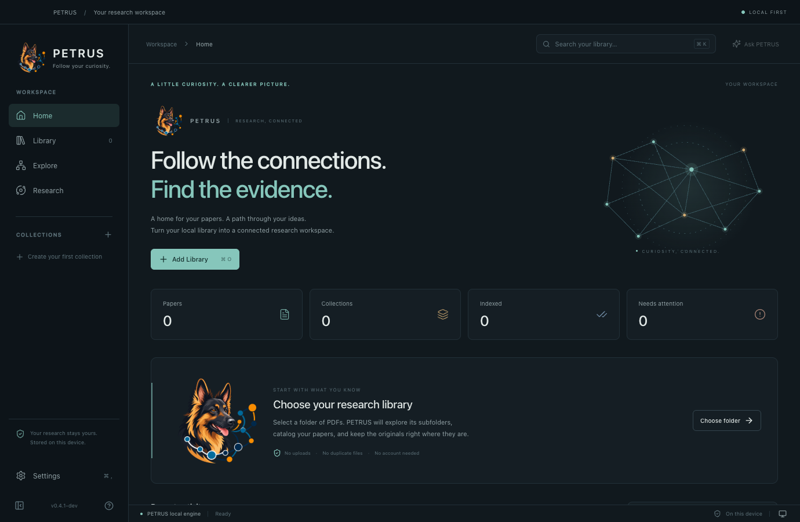

[English](../development-history.md) · **Português (Brasil)**

> Notas históricas de desenvolvimento, preservadas do README anterior em 2026-11-16. Os caminhos de pacotes, estados e comandos abaixo descrevem checkpoints sucessivos e podem estar desatualizados. Consulte o README principal para a configuração atual.

# PETRUS

**Publication Evidence Tracking, Retrieval, Understanding & Synthesis**  
*Follow the connections. Find the evidence.*

Aplicativo desktop local para transformar pastas de PDFs em uma biblioteca pesquisável. Código atual 0.4.1-dev para macOS Apple Silicon, com Tauri 2, React/TypeScript, Rust, Python e SQLite. A logo fornecida foi preservada em `app/src/assets/petrus-logo.png` e utilizada na interface e nos ícones nativos.



## Abrir o pacote do checkpoint 0.3.0-dev

O pacote já compilado permanece no checkpoint 0.3.0-dev. Para validá-lo com o banco separado, execute na raiz do projeto:

```bash
env -u PETRUS_DEV_ENGINE \
  PETRUS_DATA_DIR="$PWD/.local-data/release-checkpoint-0.3c/package-smoke" \
  ./src-tauri/target/debug/bundle/macos/PETRUS.app/Contents/MacOS/petrus
```

Esse diretório de smoke é criado pela validação local. Em outra máquina, forneça um diretório de teste próprio. A validação manual nativa e o smoke visual do pacote foram confirmados pelo usuário; o relatório separa essas confirmações de build e smoke automatizado do sidecar.

Esse pacote inclui o engine e o runtime Python. Não exige Python, Node, servidor ou terminal durante o uso. O build atual é de desenvolvimento para Apple Silicon, com assinatura ad hoc; ainda não é uma distribuição notarizada pela Apple.

Na primeira execução, clique em **Choose folder** e selecione uma pasta. Depois use **Add Library** para outras pastas. A biblioteca de desenvolvimento não é pré-configurada no produto. Os testes com dados reais usam bancos separados em `.local-data/`, ignorados pelo Git. Abrir normalmente o pacote usa o diretório de dados padrão do sistema.

## Idiomas

English · Português (Brasil). A detecção inicial segue o sistema; a escolha manual em General / Geral é persistida. O conteúdo científico permanece no idioma da fonte.

## O que está implementado

- Onboarding, Home, Library, Explore, Research, Settings e About.
- Seletor nativo, múltiplas bibliotecas, descoberta recursiva, fila em background e progresso.
- SHA-256, deduplicação global e múltiplas localizações por PDF; cache por tamanho/mtime e verificação explícita de integridade.
- Reescaneamento: novos arquivos, conteúdo alterado, arquivos removidos e locais reconectados.
- SQLite com migrations, WAL, chaves estrangeiras e FTS5.
- Texto por página, título, autores e DOI quando encontrados; identificação conservadora de abstract.
- Busca por título, autor, DOI, abstract e texto. Filtros por autor, ano, periódico, coleção e status; paginação de 100 registros.
- Painel do artigo, abertura do PDF original, revelação no sistema de arquivos e notas persistentes.
- Criação de coleções e associação manual de artigos.
- Grafo Cytoscape com citações direcionadas, autores e coleções; filtros, legenda, inspeção da referência e navegação por nós.
- Sessões com título, pergunta, descrição, data e evento de criação persistente.
- Temas System/Light/Dark, sidebar recolhível e atalhos nativos `Cmd+K`, `Cmd+O`, `Cmd+,`.
- Scan ao iniciar e watcher por polling de 60 segundos, ambos opcionais e inicialmente desativados.
- Logs JSON com rotação; parser básico isolado com timeout.
- GROBID opcional, parsing TEI hierárquico, referências e resolução exclusivamente local.
- Conteúdo Estruturado / Páginas, source spans e intervalos de página conservadores.
- Reprocessamento científico por artigo ou biblioteca na fila existente.
- Logo original maior e componente reutilizável `PetrusLogo` com tokens de tamanho.
- Retrieval híbrido lexical/semântico, EvidenceUnits com provenance e índice local de embeddings.
- Ask PETRUS em EN/PT-BR com citações clicáveis, validação estrita e um único reparo estrutural.
- LM Studio nativo `/api/v1/chat`, provider OpenAI-compatible separado, controles explícitos de saída/timeout e integração somente loopback.
- Semantic similarity opcional no grafo, com indicação de que semelhança não demonstra evidência.

A série 0.3 foi encerrada como checkpoint de desenvolvimento 0.3.0-dev, com validação manual nativa e smoke visual do pacote confirmados pelo usuário. Veja [relatório consolidado 0.3](validation-0.3-final.md).

## 0.3.1-dev — seleção de modelos do LM Studio

Em **Settings → AI / Configurações → IA**, os providers LM Studio usam listas separadas de **Chat model** e **Embedding model**. O catálogo vem de `GET http://127.0.0.1:1234/api/v1/models`: disponibilidade, carregamento e capacidades refletem o runtime e podem mudar. A classificação usa a metadata de tipo; modelos sem tipo reconhecido ficam no grupo desconhecido. Campos ausentes não recebem valores inventados.

A seleção é explícita, sem modelo predefinido: escolha e use **Save settings / Salvar configurações**. O ID exato é persistido. **Refresh models / Atualizar modelos** só relê o catálogo, sem salvar ou trocar a seleção e sem baixar/carregar modelos. Se o servidor estiver fechado ou um modelo faltar, o ID configurado permanece visível como indisponível. **Custom model ID… / ID de modelo personalizado…** mantém a entrada manual. OpenAI-compatible continua com ID manual e sem descoberta LM Studio.

**Save and check connection / Salvar e testar conexão** permanece separado: salva o formulário e testa o provider/modelo escolhido. A baseline Qwen 9B e os defaults 1600 tokens / 90 s continuam iguais. Nenhum novo benchmark Ask foi executado.

Para abrir o código atual com a cópia de validação desta máquina:

```bash
PETRUS_DATA_DIR="$PWD/.local-data/model-discovery-0.3.1/native-smoke" npm run desktop
```

Em outra máquina, use um diretório de teste próprio. Veja [validação de model discovery](validation-0.3.1-model-discovery.md).

## 0.4c — Scientific Findings & Claims

Em **Research → sessão → Findings / Achados**, use **New claim / Nova afirmação** para escrever uma afirmação científica e uma nota opcional. O texto válido é preservado exatamente, sem tradução, resumo, correção ou trim. Não há claims geradas por LLM. Limites: statement 10.000 caracteres, nota 100.000; rejeita texto vazio/só espaços e caracteres NUL.

**Add evidence / Adicionar evidência** lista somente SavedEvidence da mesma sessão. Escolha manualmente **Supports / Sustenta**, **Contradicts / Contradiz** ou **Context / Contextualiza** e confirme **Link evidence / Vincular evidência**. Essas relações expressam a classificação do pesquisador; não há verificação semântica automática ou score de verdade. As contagens são descritivas.

As três dimensões são independentes: decisão da evidência (Included/Excluded/Uncertain), relação (Supports/Contradicts/Context) e revisão da claim (Draft/Reviewed). A claim nasce Draft. **Reviewed by researcher / Revisada pelo pesquisador** exige pelo menos um vínculo e significa somente uma revisão humana, não verdade científica verificada ou revisão por pares. Remover a última fonte/vínculo conserva o status anterior e apresenta um aviso. Voltar a Draft é uma ação explícita.

Edite statement/nota com **Save claim**, altere relações explicitamente e use **Archive claim / Restore claim** para arquivar/restaurar. Arquivadas ficam fora da lista ativa e em modo de leitura até restaurar. Todas essas mudanças têm versões/transições no Research Trail. A aba Findings oferece filtros All/Draft/Reviewed/Archived; é possível navegar entre claim, evidência e paper/PDF. A evidência também mostra suas claims relacionadas.

Um vínculo conserva fingerprint, SHA do paper/texto, título/seção/páginas/provenance e referência a snapshot histórico. Remover SavedEvidence não apaga o vínculo; a fonte aparece como removida, e o texto histórico pode ser consultado quando disponível. Reprocessar/indisponibilizar a fonte não reescreve o snapshot. Não há remapeamento automático de unidade nem reconstrução de trecho perdido.

Validação isolada desta máquina: `PETRUS_DATA_DIR="$PWD/.local-data/findings-claims-0.4c/native-smoke" npm run desktop`. Veja [relatório 0.4c](validation-0.4c-findings-claims.md).

## 0.4b — Research Trail

Em **Research → sessão**, as abas **Evidence / Evidências** e **Research Trail / Trilha de pesquisa** separam o estado atual do histórico. A trilha mostra eventos em ordem cronológica, horário local e atores **You / Você**, **PETRUS** e **System / Sistema**. Filtre por ator, expanda um evento para carregar seus detalhes e use os links para a evidência, artigo ou evento de origem.

Escolha **Choose target session / Escolher sessão-alvo** **antes** de enviar uma pergunta no Ask para registrar pergunta, recuperação e resultado naquela sessão. Sem sessão-alvo, Ask continua exploratório e não cria sessão ou trilha. Recuperação não salva Evidence Cards: **Save evidence** continua sendo uma ação explícita por cartão; **Save accepted answer to session** é uma ação separada. Se a trilha falhar após o Ask, um aviso informa o registro incompleto sem repetir a geração.

A trilha preserva a resposta final validada, versões exatas de notas após **Save note**, transições de decisão e identidade de fontes removidas. Resposta rejeitada e falha técnica têm eventos distintos de evidência insuficiente. Não guarda reasoning, prompts ocultos, erros brutos do servidor ou candidatos inválidos. A aceitação estrutural não comprova suporte científico de cada afirmação.

Sessões anteriores mostram somente os eventos realmente registrados e um aviso de histórico incompleto, com uma fronteira única de início do tracking. Não há reconstrução retrospectiva de perguntas/retrieval. SavedEvidence continua um snapshot independente; a trilha não é event sourcing e não reconstrói o workspace ao abrir.

Cópia isolada desta validação: `PETRUS_DATA_DIR="$PWD/.local-data/research-trail-0.4b/native-smoke" npm run desktop`. Veja [relatório 0.4b](validation-0.4b-research-trail.md).

## 0.4a — Scientific Evidence Workspace

Em cada Evidence Card do Ask, **Save evidence / Salvar evidência** permite escolher ou criar uma Research Session. O controle **Choose target session / Escolher sessão-alvo** apenas escolhe o destino e confirma com **Use session / Usar sessão**. Nada é salvo automaticamente. O item começa **Uncertain / Incerta**, mesmo quando a resposta foi aceita. Fontes de uma resposta rejeitada também podem ser salvas por decisão humana e ficam identificadas como **retrieved source**, distintas das fontes de uma resposta aceita.

Em **Research / Pesquisa**, abra a sessão para revisar os itens, filtrar Included/Excluded/Uncertain, definir sua decisão, escrever uma **Research note / Nota do pesquisador** e usar **Save note / Salvar nota**. Decisões e notas são humanas: não há inclusão, exclusão, preenchimento de nota ou síntese automática por IA. É possível abrir os detalhes do paper, ir à biblioteca ou abrir o PDF.

SavedEvidence é um **snapshot capturado ao salvar**, produzido pelo engine a partir da EvidenceUnit atual verificada. Reprocessamento não reescreve o trecho, páginas ou heading salvos. Fonte indisponível mantém o snapshot visível. O fingerprint evita duplicar a mesma fonte na mesma sessão; sessões diferentes podem salvar a mesma evidência. IDs `E#` são locais à pergunta; IDs `span:ID`, `section:ID` e `chunk:ID` não são identidades globais permanentes.

A remoção registra um evento de auditoria básico antes de excluir o item. Decisões e notas alteradas também registram eventos, sem duplicar trechos/notas nem guardar reasoning. Esse era o histórico básico da 0.4a; a trilha completa está implementada na 0.4b, descrita acima. Detalhes e limites em [validação 0.4a](validation-0.4a-evidence-workspace.md).

## Privacidade e arquivos originais

Os PDFs são abertos somente para leitura e permanecem no local original. O banco guarda caminhos, tamanho, mtime, hash, metadados e texto extraído. O conteúdo não é enviado para a internet. Com GROBID habilitado, o PDF é enviado apenas ao serviço de parsing em loopback. Não há conta ou telemetria. Na série 0.3, embeddings e LLM são opcionais, com configuração explícita e endpoints somente loopback.

No macOS, arquivos com o atributo `UF_DATALESS` são registrados como indisponíveis localmente sem abrir o conteúdo. Para indexá-los, torne-os disponíveis offline pelo OneDrive/iCloud e execute **Rescan**. Diretórios ocultos, arquivos temporários e symlinks internos são ignorados. Falhas de permissão são registradas e a varredura continua. Uma travessia incompleta não marca arquivos não vistos como removidos.

**Remove Library** remove o vínculo da biblioteca no catálogo, sem excluir os PDFs. O conteúdo já indexado pode permanecer no banco para reutilização caso a biblioteca seja reconectada; artigos sem localização cadastrada saem da listagem e do grafo. A remoção não é uma operação de apagamento seguro do conteúdo indexado.

## Desenvolvimento no macOS

Requisitos: macOS com Command Line Tools (`xcode-select --install`), Node.js 22+, Python 3.11+ e Rust estável. O wrapper detecta também o Rust instalado localmente em `.tools/cargo` e `.tools/rustup`, como nesta máquina.

Em um checkout novo:

```bash
npm ci
python3 -m venv .venv
.venv/bin/python -m pip install -r engine/requirements-dev.lock
.venv/bin/python -m pip install -e engine --no-deps
.venv/bin/python scripts/package_engine.py
npm run desktop
```

O wrapper inicia o Vite e o Tauri; o Rust inicia e encerra o engine automaticamente. Em desenvolvimento, o engine usa o código Python da `.venv`, mesmo quando existe um sidecar compilado ao lado do executável. Alterações no frontend têm HMR; reinicie o aplicativo após alterar o engine. Não inicie outro Vite na porta 1420 antes de `npm run desktop`.

`npm run dev` abre somente o frontend para desenvolvimento visual. A biblioteca funcional requer `npm run desktop`.

### Gerar o pacote

```bash
# Reempacotar o engine após qualquer alteração no Python ou nas migrations
.venv/bin/python scripts/package_engine.py

# Build de desenvolvimento com um .app autossuficiente
npm run desktop:build

# Build otimizado (fluxo disponível; ainda sem notarização)
node scripts/desktop.mjs build --bundles app
```

Para regenerar ícones a partir do PNG original:

```bash
npm run tauri -- icon app/src/assets/petrus-logo.png
```

O script de empacotamento gera o sidecar com o sufixo do target Tauri. Compile o engine e o aplicativo no sistema e arquitetura de destino. Para Windows, o fluxo futuro usa Rust/MSVC, WebView2, Python no Windows e `--bundles nsis`. Windows e Linux ainda não foram compilados nem testados.

## Usar o GROBID opcional no Mac

```bash
bash scripts/setup_grobid.sh  # preparação inicial; internet para dependências oficiais
bash scripts/start_grobid.sh  # terminal em primeiro plano, execução offline
```

Depois, em **Settings → Indexing / Configurações → Indexação**, selecione GROBID, teste `http://127.0.0.1:8070` e reprocesse o artigo ou a biblioteca. O fallback básico continua disponível. O `.app` não embute JVM/modelos e não exige Docker. Veja [docs/grobid.md](grobid.md).

## Testes e verificações

```bash
.venv/bin/python -m pytest engine/tests -q
.venv/bin/ruff check --config ruff.toml engine scripts
npm run lint
npm run build

# Com o frontend em outro terminal: npm run dev
npm exec playwright -- test
```

Os testes de interface usam o **engine Python real com PDFs/TEI sintéticos**; substitui apenas IPC, seletor de pastas e ações do sistema operacional. Por padrão usa o Chrome instalado no caminho padrão do macOS. Defina `PETRUS_CHROME` para outro executável Chromium. Não usa sua biblioteca real nos testes automatizados. Veja o escopo e as evidências em [docs/validation-0.2.md](validation-0.2.md). O registro histórico da 0.1 permanece em [docs/validation.md](validation.md).

## Dados locais e diagnóstico

No macOS, o diretório padrão é `~/Library/Application Support/org.petrus.desktop/`. O caminho exato aparece em **Settings → General**. Ele contém `petrus.sqlite3` e `logs/engine.jsonl` (5 MB, três backups). Os logs podem conter caminhos e nomes de PDFs; permanecem no computador. Para testes locais, `PETRUS_DATA_DIR` pode apontar para outro diretório; não é uma configuração necessária para o usuário.

Se uma pasta for desconectada, reconecte-a e faça **Rescan**. Se um PDF estiver com senha, corrompido, vazio ou exceder os limites do parser, os outros documentos continuam. Se o engine encerrar inesperadamente, reinicie o aplicativo. Jobs interrompidos são identificados no início e podem ser retomados por uma nova varredura.

## Limitações desta versão

- pypdf é um parser básico. Título/autores podem faltar ou conter metadados editoriais inadequados. Journal e ano de publicação ficam desconhecidos quando não há extração confiável; a data de criação do PDF não é tratada como data de publicação. Abstract é uma extração heurística.
- DOI extraído localmente é candidato, sem validação externa. Não há consulta a Crossref, OpenAlex ou outros serviços.
- Camada pypdf limitada a 300 páginas e 100 mil caracteres por página; sem OCR. GROBID é opcional e seus metadados precisam de conferência. Seções sem provenance confiável mantêm páginas desconhecidas.
- Grafo limitado aos 300 artigos mais recentes, até 2.000 vínculos por tipo autor/coleção e 4.000 citações. Somente referências resolvidas geram `CITES`; autor/coleção não implicam citação ou concordância científica.
- Watcher é polling, não eventos nativos. Rescans confiam em tamanho/mtime inalterados; `verify_integrity` é a operação explícita para detectar alterações que preservem esses atributos.
- Embeddings e RAG local estão implementados e são opcionais. Ask PETRUS usa fontes rastreáveis, validação estrita e reparo limitado; a aceitação estrutural não substitui a avaliação científica humana. Providers operam somente em loopback, com seleção explícita em Settings → AI.
- Sessões possuem SavedEvidence e Research Trail completo; relatórios e síntese permanecem fora do escopo atual.
- Sem migração automática de referências quando pastas são movidas. Adicione a nova localização e remova a antiga após a varredura.

## Estrutura e evolução

```text
app/src/                 React, componentes, serviços e tokens de tema
src-tauri/src/           Shell Rust, menus, IPC e OSService
src-tauri/migrations/    Schema SQLite versionado
src-tauri/icons/         Ícones derivados do PNG original
engine/petrus_engine/    Banco, ingestão, parser, grafo e contratos de IA
engine/tests/fixtures/  PDFs sintéticos pequenos
scripts/                Execução e empacotamento do sidecar
tests/                  Fluxo de interface com engine real
docs/                   Arquitetura, modelo de dados, roadmap e validação
```

Veja [arquitetura](architecture.md), [banco de dados](database.md) e [roadmap](roadmap.md). O registro da versão 0.2 está em [validation-0.2.md](validation-0.2.md). Internacionalização: [i18n.md](i18n.md). O desenvolvimento posterior de embeddings/Ask local está registrado abaixo; agentes e serviços de descoberta externos continuam fora do escopo.

## Development cleanup / Limpeza do ambiente

Etapa interna 0.2.1: contratos de RAG e provenance estão preparados no engine; ainda não há embeddings/RAG. O `.app` 0.2 já validado não foi recompilado nesta etapa.

A limpeza usa uma lista fixa de destinos do projeto. **O padrão é dry-run**, inclusive sem flag. Não toca em `.tools`, dados normais do aplicativo, biblioteca de PDFs, fontes, migrations, assets, documentação ou screenshots. Recusa destinos com symlinks ou PDFs. Feche os processos de desenvolvimento antes de executar uma remoção.

```bash
bash scripts/clean.sh --dry-run build
bash scripts/clean.sh --dry-run validation
bash scripts/clean.sh --dry-run deep

# Somente após conferir o plano:
bash scripts/clean.sh --execute build
bash scripts/clean.sh --execute validation
# Deep exige as duas flags e inclui build + validation + node_modules + .venv:
bash scripts/clean.sh --execute --confirm-deep deep
```

`build` remove outputs Tauri/frontend/PyInstaller, sidecar gerado e caches de teste conhecidos. Isso remove também o `.app` gerado: será necessário reconstruí-lo antes de abrir esse caminho. `validation` remove somente as pastas temporárias nomeadas da auditoria, incluindo a cópia PETRUS Validation.app; não remove `docs/validation*.md` nem screenshots. Pastas futuras desconhecidas não entram automaticamente. Consulte a [auditoria de espaço](development-cleanup-audit-0.2.1.md).

Após deep, reinstale dependências com os locks existentes:

```bash
npm ci
python3 -m venv .venv
.venv/bin/python -m pip install -r engine/requirements-dev.lock
.venv/bin/python -m pip install -e engine --no-deps
```

Para reconstruir os artefatos de build, use os comandos de empacotamento/build documentados acima. GROBID, JDK e Rust locais não são apagados nem reinstalados pelo clean.

## Desenvolvimento 0.3b — Ask PETRUS local

O código atual acrescenta Ask PETRUS com fontes clicáveis, filtros de bibliografia, subdivisão de unidades, diversidade, boost por seção e similaridade semântica. Execute `npm run desktop` para trabalhar com o engine atual. Em **Settings → AI / Configurações → IA**, configure separadamente embeddings e o LLM local, usando IDs exatos. Geração permanece desligada até escolher um modelo; nada é baixado automaticamente. Expansão de query é opcional. O pacote `.app` anterior ainda corresponde à versão previamente compilada.

Escopo e limites: [validação 0.3b](validation-0.3b-arbovirus.md). Citações verificam rastreabilidade, não garantem a sustentação científica de cada frase.
